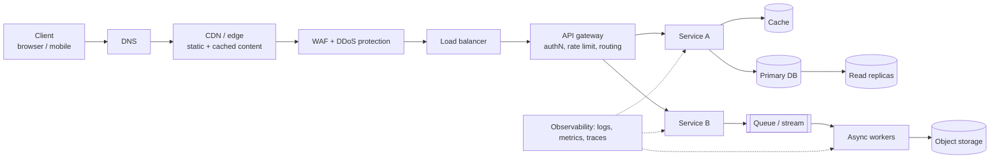
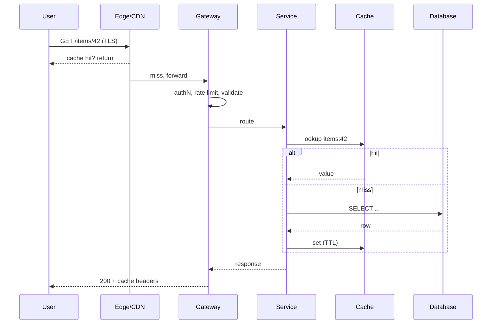

# 01. Foundations: The Big Picture

Start here. Before any single concept, you need the map: what a typical system looks like, what "good" means, and how to reason about numbers and trade-offs.

---

## 1. Big picture: anatomy of a modern system

Almost every web-scale system is the same set of layers. Each layer exists to solve one problem.



| Layer | Problem it solves | Chapter |
|---|---|---|
| DNS / CDN / edge | Latency, offloading static traffic | 04, 08 |
| WAF / gateway | Attack filtering, auth, throttling | 02 |
| Load balancer | Spread load, health-aware routing | 04, 08 |
| Stateless services | Horizontal scalability | 04, 06 |
| Cache | Cut latency and DB load | 04 |
| Database + replicas | Durable state, read scale | 04, 07 |
| Queue / workers | Decouple, absorb spikes, retry | 03, 07 |
| Observability | See what is actually happening | 05, 09 |

## 2. Structure: quality attributes

"Secure, resilient, high-performing" are three of several **quality attributes** (also called non-functional requirements). Always translate them into measurable targets.

| Attribute | Question | Typical metric |
|---|---|---|
| Security | Who can do what; what if they lie? | Time to patch, % data encrypted, audit coverage |
| Availability | Is it up? | 99.9% = 43.8 min downtime/month; 99.99% = 4.4 min |
| Reliability | Does it do the right thing under failure? | Error rate, MTTR, MTBF |
| Performance | How fast for one request? | p50/p95/p99 latency |
| Scalability | Can it grow 10x? | Throughput (RPS) at target latency |
| Durability | Is data ever lost? | RPO (max data loss), "11 nines" |
| Operability | Can we run and debug it? | Deploy frequency, MTTD/MTTR |
| Cost | Can we afford it? | Cost per request / per user |

**Availability math** (worth memorizing):

```
Serial dependencies multiply:     A_total = A1 x A2 x A3
  3 services at 99.9% each      = 99.7%

Parallel redundancy improves:     A_total = 1 - (1 - A)^n
  2 replicas at 99.9% each      = 99.9999%
```

Lesson: every extra hard dependency in the request path **lowers** availability; every independent replica **raises** it.

## 3. Behaviour: life of a request



Where latency hides: DNS lookup, TLS handshake, network hops, cache miss, DB query, serialization, queueing under load.

## 4. Implementation: back-of-envelope estimation

A repeatable recipe: **users, requests, data, bandwidth, servers**.

**Example: photo-sharing service, 10M daily active users (DAU)**

```
Writes:  10M DAU x 2 uploads/day            = 20M/day  -> ~230 writes/s average
Peak:    assume 3x average                  -> ~700 writes/s
Reads:   10M DAU x 50 views/day             = 500M/day -> ~5,800 reads/s, peak ~17k/s
Storage: 20M uploads x 2 MB                 = 40 TB/day -> ~14.6 PB/year
Egress:  17k reads/s x 200 KB (thumbnails)  = ~3.4 GB/s peak -> CDN is mandatory
App servers: 17k RPS / ~1k RPS per node     = ~17 nodes at peak, run ~30 for headroom + AZ loss
```

Conclusions you can now defend: read-heavy (25:1) so cache + CDN + replicas; object storage not a DB for blobs; multi-AZ with N+1 capacity.

**Latency numbers every engineer should feel** (order of magnitude):

| Operation | Time |
|---|---|
| L1/L2 cache reference | 1 to 10 ns |
| Main memory reference | 100 ns |
| SSD random read | 100 us |
| Same-datacenter round trip | 0.5 ms |
| Read 1 MB from SSD | 1 ms |
| Cross-region round trip (EU to US) | 80 to 150 ms |
| TCP + TLS handshake (fresh, cross-region) | 200 to 400 ms |

## 5. Trade-offs: the core skill

There is no best design, only a best fit for the constraints. Recurring tensions:

| Tension | Choosing left means... | Choosing right means... |
|---|---|---|
| Consistency vs availability | Correct but may refuse during partition | Always answers, maybe stale |
| Latency vs durability | Ack after memory write: fast, can lose data | Ack after fsync/replication: slower, safe |
| Simplicity vs scalability | Monolith, one DB: easy to reason about | Microservices, sharding: scales, harder to operate |
| Cost vs redundancy | Single AZ: cheap | Multi-region: expensive, resilient |
| Build vs buy | Control, no lock-in | Speed, less ops burden |

**Record decisions as ADRs** (Architecture Decision Records):

```markdown
# ADR-007: Use PostgreSQL with read replicas, not DynamoDB
Status: Accepted (2026-10-23)
Context: Relational queries, moderate scale (< 5k writes/s), team knows SQL.
Decision: Aurora PostgreSQL, 1 writer + 2 readers across 3 AZs.
Consequences: (+) joins, transactions. (-) vertical write ceiling; revisit at 10x growth.
Alternatives considered: DynamoDB (rejected: ad-hoc queries needed).
```

## 6. Finer details

- **Percentiles beat averages.** A p99 of 2 s with a mean of 80 ms still ruins 1 in 100 users, and in fan-out calls (one request hits 10 services) the user sees roughly the slowest.
- **Tail amplification**: if each of 10 backends has p99 = 1 s, then ~10% of fan-out requests hit at least one slow call.
- **Peak vs average**: size for peak, but check cost of idle capacity; autoscaling closes the gap only if it reacts faster than the spike.
- **Failure is normal** at scale: disks, hosts, AZs, dependencies, and your own deploys fail. Design for it, do not hope.
- **Non-functional requirements first.** Ask for RPS, data volume, latency target, consistency need, RPO/RTO, and compliance before drawing boxes.

## Self-check

1. Why does adding a fourth synchronous dependency lower availability even if it is 99.99%?
2. Given 5,000 reads/s and 100 writes/s, which layers do you add first, and why?
3. Which numbers in the estimation example would change if photos were 20 MB videos?
