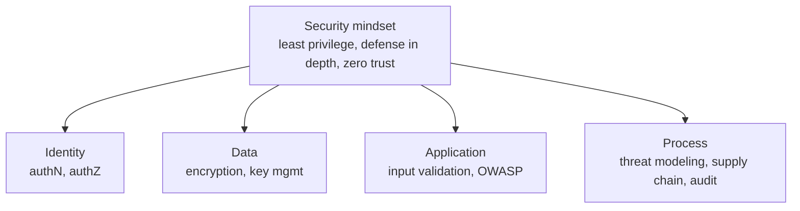
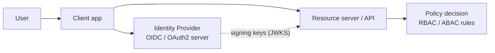
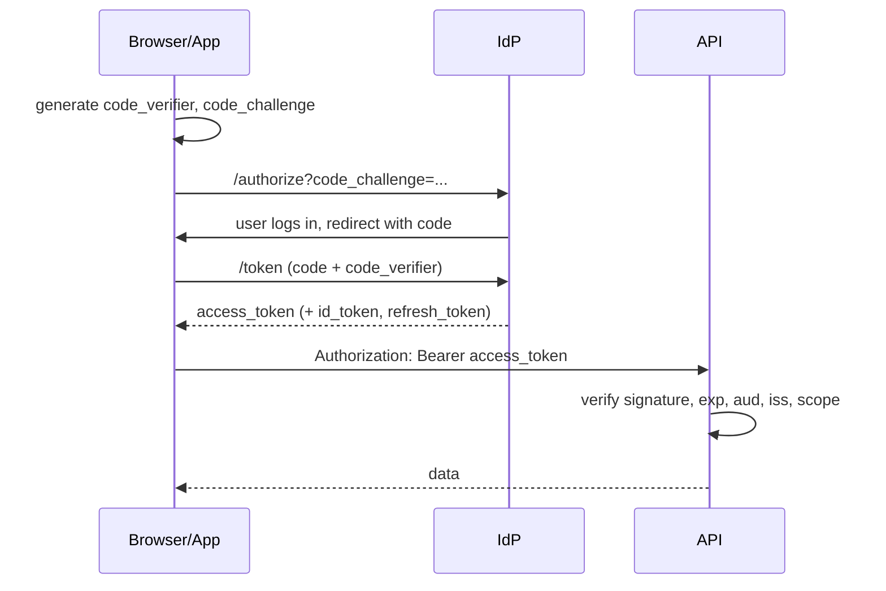
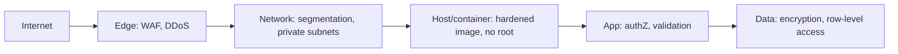
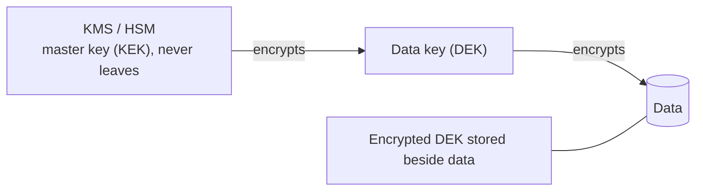
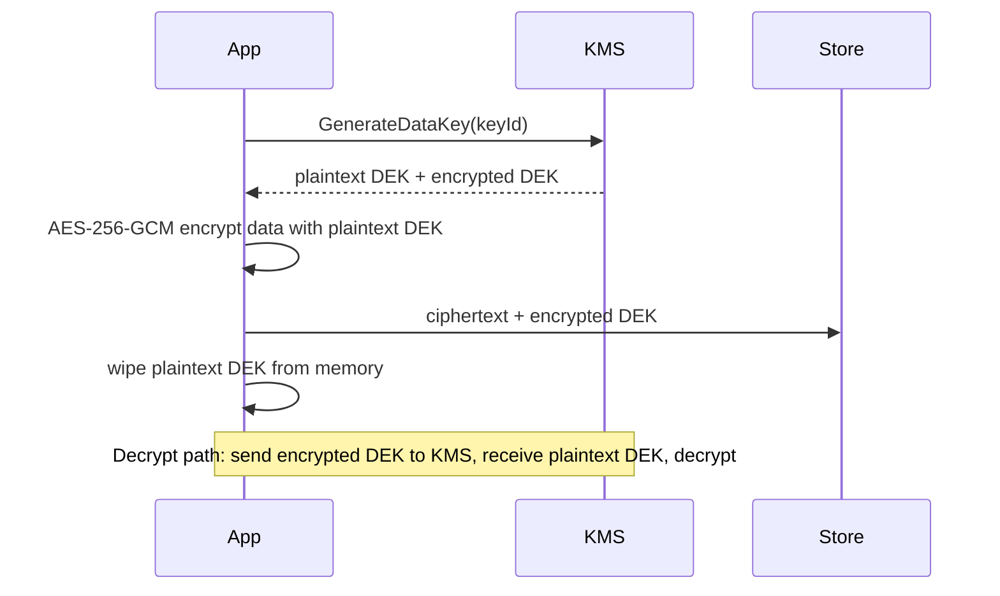
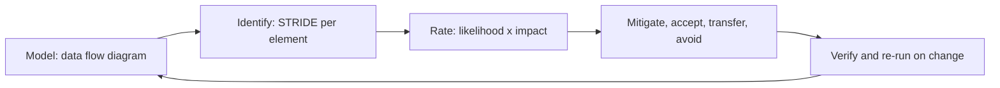

# 02. Security

Security is not a layer you add; it is a property of every layer. The common thread: **assume breach, minimize blast radius, verify everything explicitly.**

---

## Chapter map



---

## Anchor concept 1: Authentication and authorization

### 1. Big picture
- **AuthN** = who are you? **AuthZ** = what may you do?
- Modern systems delegate identity to an **Identity Provider (IdP)** and use **tokens** instead of passwords at every service.

### 2. Structure



| Term | Meaning |
|---|---|
| OAuth2 | Framework for delegated **authorization** (access tokens, scopes) |
| OIDC | Identity layer on OAuth2 (ID token = who the user is) |
| JWT | Signed token format: header.payload.signature |
| RBAC | Permissions via roles: `admin`, `editor` |
| ABAC | Permissions via attributes/policies: `dept == finance AND time < 18:00` |

### 3. Behaviour: Authorization Code + PKCE (the standard for web/mobile)



### 4. Implementation (Spring Boot resource server)

```java
@Configuration
@EnableMethodSecurity
class SecurityConfig {
  @Bean
  SecurityFilterChain api(HttpSecurity http) throws Exception {
    return http
      .csrf(csrf -> csrf.disable())                       // stateless bearer API
      .authorizeHttpRequests(a -> a
          .requestMatchers("/health").permitAll()
          .requestMatchers(HttpMethod.GET, "/orders/**").hasAuthority("SCOPE_orders.read")
          .anyRequest().authenticated())
      .oauth2ResourceServer(o -> o.jwt(Customizer.withDefaults())) // validates iss/exp/sig via JWKS
      .build();
  }
}
// Object-level check (the one people forget):
@PreAuthorize("@orderAuth.isOwner(#id, authentication)")
@GetMapping("/orders/{id}") Order get(@PathVariable UUID id) { ... }
```

### 5. Trade-offs

| Choice | Pro | Con |
|---|---|---|
| Stateless JWT | No session store, scales trivially | Hard to revoke before expiry; keep lifetimes short |
| Server-side sessions | Instant revoke, small cookie | Needs shared store, sticky or distributed |
| RBAC | Simple to audit | Role explosion |
| ABAC / policy engine (OPA, Cedar) | Fine-grained, central | More complexity, harder to debug |

### 6. Finer details
- Validate **every** claim: signature, `iss`, `aud`, `exp`, `nbf`. Reject `alg: none`; pin accepted algorithms.
- Authorization must be checked **per object** (BOLA/IDOR is the top API vulnerability), not just per endpoint.
- Access tokens: 5 to 15 min. Refresh tokens: rotate on use, detect reuse.
- Store tokens in `HttpOnly; Secure; SameSite` cookies for browsers rather than `localStorage`.
- Never roll your own crypto or password storage: use Argon2id/bcrypt/scrypt, or better, delegate to an IdP.

---

## Anchor concept 2: Defense in depth, least privilege, zero trust

### 1. Big picture
No single control is reliable, so stack independent ones, give each component the minimum power, and never trust a request just because it came from "inside" the network.

### 2. Structure



### 3. Behaviour: zero trust service call
Each call carries identity (mTLS certificate or workload token); the callee authenticates the caller **and** authorizes the specific action. Network location grants nothing.

### 4. Implementation
- mTLS between services via a service mesh (Istio, Linkerd) or cloud workload identity.
- Per-service IAM roles; DB credentials issued dynamically (Vault, IAM auth) with short TTL.
- Kubernetes `NetworkPolicy` default-deny, allow only declared paths.

### 5. Trade-offs
Strong isolation adds operational overhead (certificate rotation, policy upkeep) and debugging friction. Automate it, or people will bypass it.

### 6. Finer details
Common failure: one overly broad role (`*:*`) attached to many workloads. Review with access-analyzer tools; audit unused permissions quarterly.

---

## Anchor concept 3: Encryption and key management

### 1. Big picture
- **In transit**: TLS 1.2+ (prefer 1.3). **At rest**: disk/object/DB encryption. **In use**: confidential computing (niche).
- The hard part is not the cipher; it is **who holds the keys**.

### 2. Structure: envelope encryption



### 3. Behaviour



### 4. Implementation notes
Use your cloud SDK's envelope helpers (AWS Encryption SDK, Azure Key Vault wrap/unwrap, GCP Tink). Use AEAD modes (AES-GCM, ChaCha20-Poly1305) so tampering is detected.

### 5. Trade-offs

| Option | Pro | Con |
|---|---|---|
| Provider-managed keys | Zero effort | Less control, shared trust |
| Customer-managed keys (CMK) | Own rotation, revoke = crypto-shred | You can lock yourself out; KMS call cost/latency |
| Client-side encryption | Provider never sees plaintext | Search/indexing impossible without extra schemes |

### 6. Finer details
Rotate keys on a schedule; keep old key versions for decrypt. Never reuse a nonce with GCM. KMS has request quotas: cache data keys briefly for high-throughput paths.

---

## Anchor concept 4: Threat modeling (STRIDE)

### 1. Big picture
Find what can go wrong **before** building it. Draw the system, mark **trust boundaries**, then ask STRIDE questions at every boundary crossing.

### 2. Structure

| Letter | Threat | Violates | Typical control |
|---|---|---|---|
| **S** | Spoofing | Authentication | Strong authN, mTLS |
| **T** | Tampering | Integrity | Signatures, AEAD, checksums |
| **R** | Repudiation | Non-repudiation | Immutable audit logs |
| **I** | Information disclosure | Confidentiality | Encryption, least privilege |
| **D** | Denial of service | Availability | Rate limits, autoscale, quotas |
| **E** | Elevation of privilege | Authorization | Least privilege, input validation |

### 3. Behaviour: the loop



### 4. Implementation example
Element: "Browser to API over the public internet" crosses a trust boundary.
- S: stolen token -> short expiry, token binding, MFA.
- T: modified request -> TLS, request signing for sensitive ops.
- I: response leaks other users' data -> object-level authZ tests.
- D: flood -> WAF, per-client rate limit.

### 5. Trade-offs
Heavyweight sessions get skipped. Prefer small, frequent, lightweight models tied to design reviews.

### 6. Finer details
Add abuse cases and business-logic threats (coupon abuse, enumeration), which STRIDE alone under-weights.

---

## Concept map: everything else in security

| Concept | What | How | Trade-off / gotcha |
|---|---|---|---|
| Input validation | Reject malformed input at boundaries | Allow-lists, schema validation (JSON Schema, Bean Validation) | Validation is not a substitute for output encoding |
| Injection (SQL, command, NoSQL) | Untrusted input interpreted as code | Parameterized queries, no string concatenation | ORMs help but raw fragments still bite |
| XSS | Script injected into pages | Contextual output encoding, CSP header, templating auto-escape | CSP needs tuning; breaks inline scripts |
| CSRF | Browser sends cookies cross-site | `SameSite` cookies, anti-CSRF tokens | Not needed for pure bearer-header APIs |
| SSRF | Server tricked into calling internal URLs | Egress allow-list, block link-local (169.254.169.254), IMDSv2 | Common cloud-credential theft path |
| Rate limiting | Cap abuse | Token bucket per user/IP/key | Shared NATs cause false positives |
| Secrets management | No secrets in code/images | Vault / cloud secret store, short-lived creds, rotation | Bootstrap problem: how does the app first authenticate? |
| Auditability | Reconstruct who did what | Append-only, tamper-evident logs, ship off-host | Never log secrets or full PII |
| Supply chain | Malicious/vulnerable dependencies | Pin versions, SCA scanning, SBOM, signed artifacts (Sigstore), minimal base images | Update fatigue; automate with bots |
| Secure defaults | Safe unless opted out | Deny by default, security headers, no debug in prod | Convenience vs safety |
| Data minimization / privacy | Collect and keep less | Retention policies, pseudonymization, field-level encryption | GDPR: erasure vs backups needs design |

## Self-check
1. Why is a valid JWT not enough to authorize `GET /orders/42`?
2. What does crypto-shredding mean and what must be true for it to work?
3. Do a 5-minute STRIDE pass on "password reset by email link".
