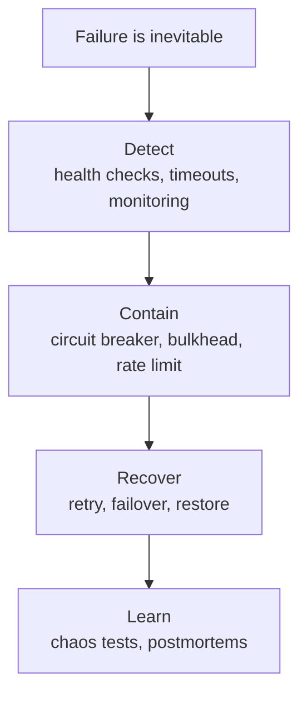
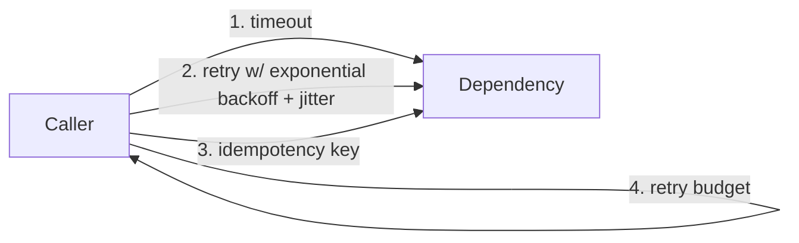
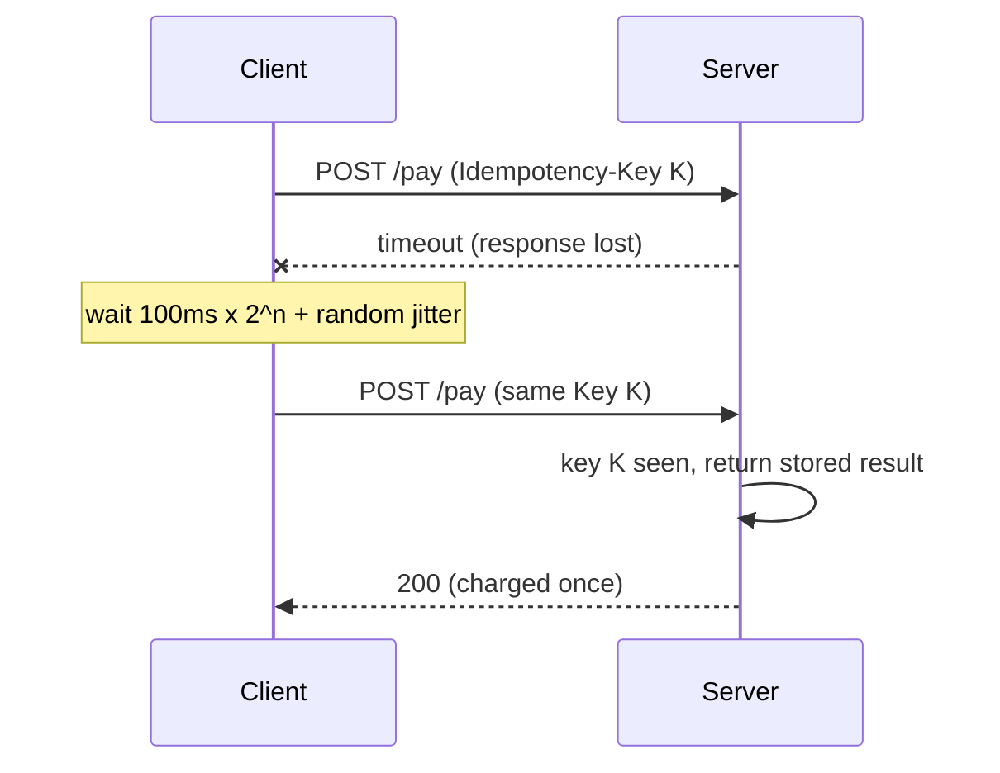
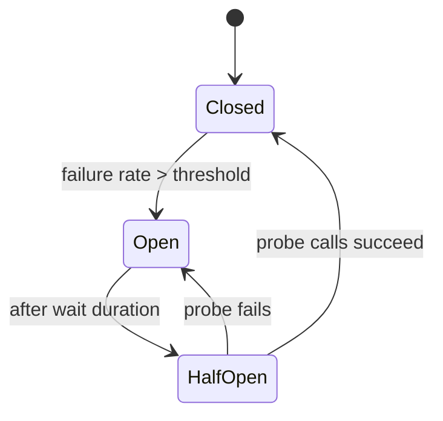
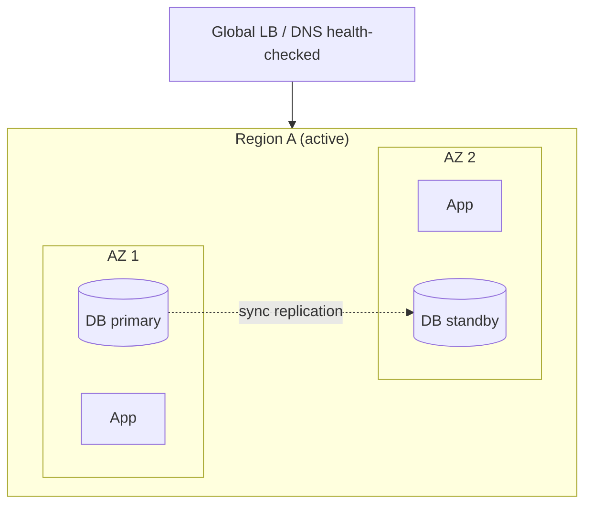
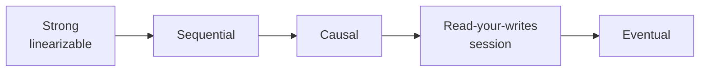
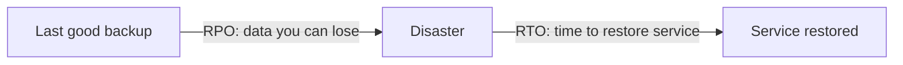

# 03. Resilience

Resilience = the system **keeps delivering acceptable service while parts of it fail**, and recovers quickly. Prevention is impossible; containment and recovery are the job.

---

## Chapter map



---

## Anchor concept 1: Timeouts, retries, backoff, jitter, idempotency

### 1. Big picture
Networks drop packets; services stall. A call without a timeout can hang forever and exhaust your threads. A blind retry can turn a blip into an outage (retry storm). These four tools together make calls safe.

### 2. Structure



### 3. Behaviour



### 4. Implementation

```java
// Spring Boot + Resilience4j
@Retry(name = "inventory", fallbackMethod = "stale")
@TimeLimiter(name = "inventory")
public CompletableFuture<Stock> stock(String sku) { ... }
```
```yaml
resilience4j.retry.instances.inventory:
  max-attempts: 3
  wait-duration: 200ms
  enable-exponential-backoff: true
  exponential-backoff-multiplier: 2
  enable-randomized-wait: true          # jitter
  retry-exceptions: [java.io.IOException, java.util.concurrent.TimeoutException]
```
```js
// Plain JS: full jitter backoff
async function withRetry(fn, {max = 4, base = 100, cap = 5000} = {}) {
  for (let n = 0; ; n++) {
    try { return await fn(); }
    catch (e) {
      if (n === max - 1 || !isRetryable(e)) throw e;
      const delay = Math.random() * Math.min(cap, base * 2 ** n);   // full jitter
      await new Promise(r => setTimeout(r, delay));
    }
  }
}
```

### 5. Trade-offs

| Decision | Risk if too aggressive | Risk if too lax |
|---|---|---|
| Short timeout | False failures | Thread/connection exhaustion |
| Many retries | Retry storm amplifies outage | Transient errors surface to users |
| Retrying non-idempotent calls | Double charge/duplicate | Lost operations |

### 6. Finer details
- Retry **only** transient errors (5xx, 429, network). Never retry 4xx validation errors.
- Retries multiply across layers: 3 layers x 3 tries = 27 calls to the bottom. Retry at one layer, or use a **retry budget** (e.g. max 10% extra traffic).
- Honor `Retry-After`. Set a timeout shorter than the caller's own deadline (propagate deadlines).
- Idempotency key store needs TTL and must record in-progress state to avoid concurrent duplicates.

---

## Anchor concept 2: Circuit breaker (plus bulkhead)

### 1. Big picture
When a dependency is clearly failing, stop calling it. That gives it room to recover and keeps your threads free. **Bulkheads** isolate resources so one slow dependency cannot drain everything (like ship compartments).

### 2. Structure and behaviour: state machine



- **Closed**: calls flow, failures counted in a sliding window.
- **Open**: calls fail fast (or use fallback) with no network call.
- **Half-open**: a few trial calls decide whether to close.

### 3. Implementation

```yaml
resilience4j:
  circuitbreaker.instances.payments:
    sliding-window-size: 50
    failure-rate-threshold: 50
    slow-call-duration-threshold: 2s
    slow-call-rate-threshold: 80
    wait-duration-in-open-state: 30s
    permitted-number-of-calls-in-half-open-state: 5
  bulkhead.instances.payments:
    max-concurrent-calls: 20          # isolate pool for this dependency
```

### 4. Trade-offs
Fail-fast protects you but turns partial degradation into definite errors for that feature, so define a **fallback** (cached value, default, queue for later, hide the widget).

### 5. Finer details
Count **slow** calls as failures too. Tune per dependency, not globally. Expose breaker state in metrics and alert on opens.

---

## Anchor concept 3: Redundancy and failover

### 1. Big picture
Remove single points of failure (SPOFs) by running multiple independent copies and routing around failed ones.

### 2. Structure



| Pattern | How | Failover time | Cost |
|---|---|---|---|
| Active-passive (hot standby) | Standby ready, takes over on failure | Seconds to minutes | Medium |
| Active-active | All nodes serve traffic | Near zero | High, needs conflict handling |
| N+1 / N+2 | Capacity for N plus spares | n/a | Low to medium |

### 3. Behaviour
Health checks detect failure -> LB stops routing to the node -> (for stateful) a leader election or promotion makes a replica primary -> clients reconnect.

### 4. Trade-offs and details
- Synchronous replication = no data loss but higher write latency and availability coupling; async = fast but RPO > 0.
- **Split brain**: two nodes both think they are primary. Prevent with quorum/fencing tokens.
- Redundancy only helps if failures are **independent** (different AZs, different deploy waves, different dependencies).
- Test failover regularly; untested failover is a hope, not a feature.

---

## Anchor concept 4: CAP theorem and consistency models

### 1. Big picture
When a network **partition** happens, a distributed data store must choose: stay **consistent** (refuse some requests) or stay **available** (answer, possibly stale). Partitions are not optional, so the real choice is C or A *during* a partition. Otherwise the trade-off is **latency vs consistency** (PACELC).

### 2. Structure: spectrum


Left = easier to reason about, slower, less available. Right = faster, available, needs conflict handling.

### 3. Behaviour: quorum reads/writes

```
N replicas, write acked by W, read from R.
R + W > N  ->  read set overlaps latest write  ->  strong-ish consistency
Example N=3: W=2, R=2 (consistent); W=1, R=1 (fast, may be stale)
```

### 4. Example decisions

| Data | Choice | Why |
|---|---|---|
| Bank balance, inventory last unit | CP / strong | Wrong answer is costly |
| Social feed, like counts, product views | AP / eventual | Staleness is harmless |
| User profile | Read-your-writes | User must see own edit |

### 5. Finer details
Eventual consistency needs a **conflict resolution** story: last-write-wins (loses data), vector clocks, CRDTs, or app-level merge. "Strong" in a vendor's marketing may mean per-partition only; check the fine print.

---

## Anchor concept 5: Backup, RPO/RTO, disaster recovery

### 1. Big picture
Replication protects against hardware failure, **not** against deletion, corruption or ransomware (those replicate instantly). Backups protect against those.

### 2. Structure



| DR tier | RPO / RTO | Cost |
|---|---|---|
| Backup & restore | hours / hours to days | $ |
| Pilot light | minutes / tens of minutes | $$ |
| Warm standby | seconds-minutes / minutes | $$$ |
| Multi-site active-active | ~0 / ~0 | $$$$ |

### 3. Implementation checklist
- 3-2-1 rule: 3 copies, 2 media/accounts, 1 offsite/immutable (object lock / WORM).
- Point-in-time recovery for databases; separate backup account with restricted delete rights.
- **Restore drills** on a schedule with measured RTO. A backup never restored is unproven.

---

## Concept map: everything else in resilience

| Concept | What | How | Trade-off / gotcha |
|---|---|---|---|
| Rate limiting | Cap load per client | Token bucket / leaky bucket / sliding window; gateway or Redis-based | Distributed counters add latency; choose fail-open vs fail-closed |
| Load shedding | Drop low-priority work when overloaded | Priority queues, reject early with 503 + `Retry-After` | Needs request classification |
| Graceful degradation | Reduced but useful service | Feature flags, serve cached/stale, disable non-critical features | Must be designed and tested ahead |
| Backpressure | Slow producers when consumers lag | Bounded queues, reactive streams, 429/pause signals | Unbounded queues just move the failure to memory |
| Queues for decoupling | Absorb bursts, retry later | Broker + workers + DLQ | Adds latency and eventual consistency |
| Health checks | Detect bad instances | **Liveness** (restart me) vs **readiness** (stop sending traffic); startup probes | Deep checks that call dependencies can cascade-restart everything; keep liveness shallow |
| Chaos engineering | Prove resilience empirically | Inject failures in controlled blast radius (Chaos Monkey, Litmus, AWS FIS) | Needs observability and rollback first |
| Timeouts + deadlines | Bound waiting | Propagate remaining deadline downstream | Mismatched timeouts across layers |
| Graceful shutdown | Don't drop in-flight work | Drain connections, SIGTERM handling, preStop hook | Forgetting it causes errors on every deploy |
| Metastable failures | Overload that persists after the trigger ends | Shed load, cap retries, avoid cold-cache stampedes | Subtle; often discovered in production |

## Self-check
1. Why can retries at three layers cause a 27x load amplification?
2. Replication is on. Someone runs `DELETE FROM orders` without WHERE. What saves you?
3. Pick CP or AP for: seat booking, "users online now" counter, password change. Justify.
