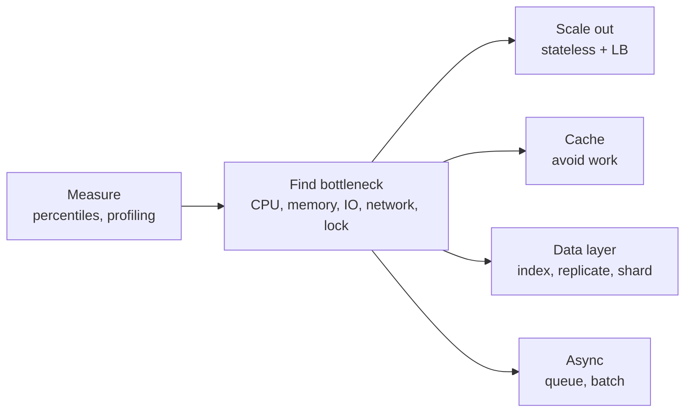
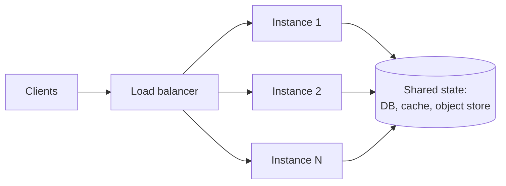
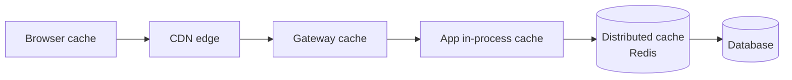
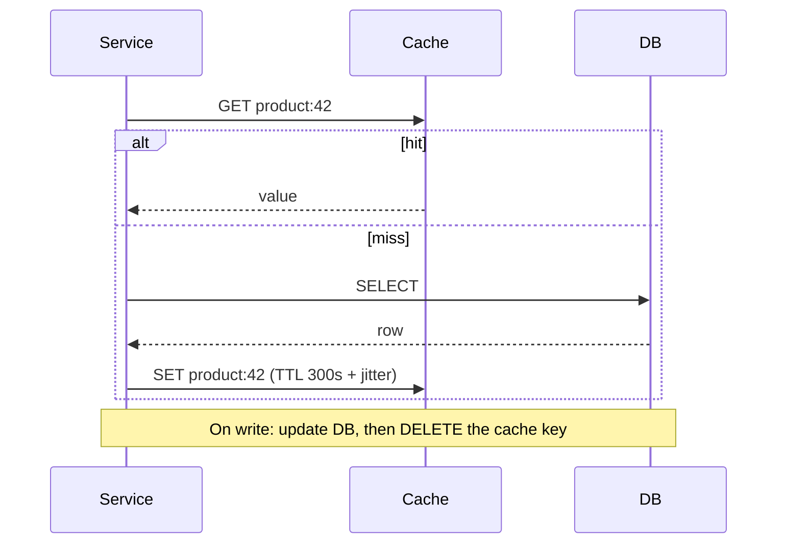
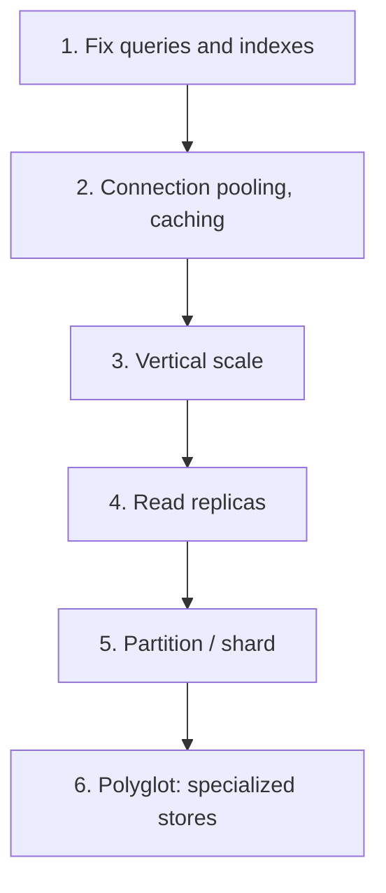
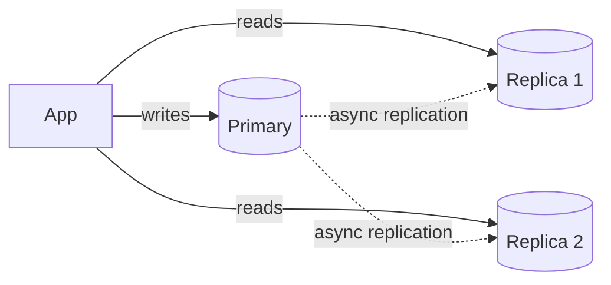
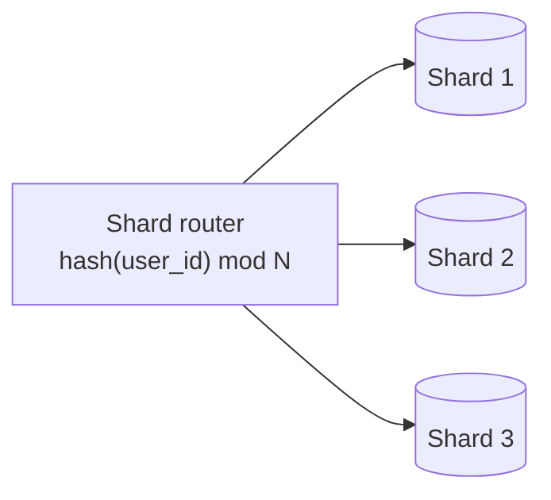
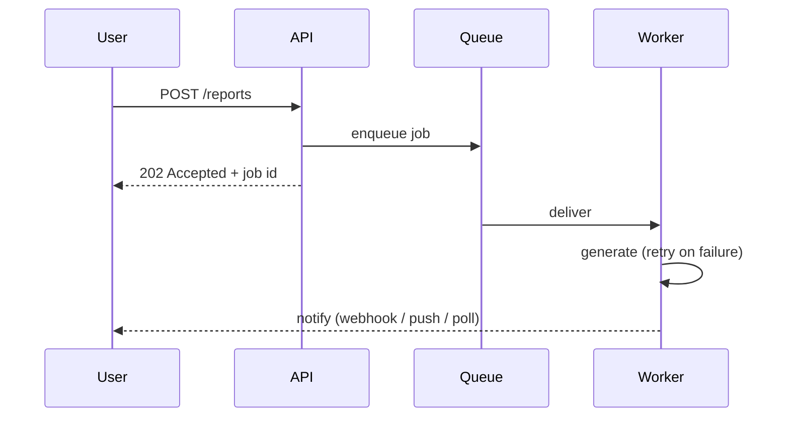

# 04. Performance and Scalability

Performance = how fast one request is. Scalability = whether performance holds as load grows. Optimize in this order: **measure, find the bottleneck, fix the biggest one, repeat.**

---

## Chapter map



---

## Anchor concept 1: Horizontal scaling, stateless services, load balancing

### 1. Big picture
Vertical scaling (bigger box) hits a ceiling and a single point of failure. Horizontal scaling (more boxes) is near-linear **if** instances are interchangeable, which means **stateless**.

### 2. Structure



### 3. Behaviour: balancing algorithms

| Algorithm | Best for | Weakness |
|---|---|---|
| Round robin | Uniform, short requests | Ignores load differences |
| Least connections / least request | Variable request cost | Needs connection tracking |
| Weighted | Mixed instance sizes | Manual tuning |
| Consistent hashing | Cache affinity, sharded backends | Hot keys unbalance |
| Power of two choices | Large fleets, near-optimal | Slightly more logic |

**L4 vs L7**: L4 (TCP/UDP) is fast and protocol-agnostic. L7 (HTTP) can route by path/header, terminate TLS, retry, and do auth, at higher cost.

### 4. Implementation: making a service stateless
- Sessions: signed token or Redis-backed session, not in-process memory.
- Uploads: straight to object storage via pre-signed URL, not local disk.
- Config from environment; no reliance on local files; graceful shutdown.
- Autoscale on a leading metric (RPS per instance, queue depth), not only CPU.

### 5. Trade-offs and details
- Sticky sessions are a crutch: they unbalance load and break on failover.
- Scale-out moves the bottleneck to shared state (DB, cache, locks). That is the next problem.
- Cold start and warm-up: new instances serve slowly until JIT/caches warm; use slow-start in the LB.
- Little's Law: `concurrency = throughput x latency`. 2,000 RPS at 100 ms needs about 200 requests in flight; size thread/connection pools accordingly.

---

## Anchor concept 2: Caching

### 1. Big picture
The fastest request is the one you do not make. Caching trades **freshness** and **memory** for latency and load reduction.

### 2. Structure: cache layers


Each layer to the right is slower but larger and more shared.

### 3. Behaviour: cache-aside (most common)



| Pattern | Write path | Use when |
|---|---|---|
| Cache-aside | App manages cache | Default, read-heavy |
| Read-through | Cache loads on miss | Library/managed support |
| Write-through | Write cache and DB together | Read-after-write needed, simple |
| Write-behind | Write cache, flush async | Write-heavy, can tolerate loss risk |

### 4. Implementation

```js
async function getProduct(id) {
  const key = `product:${id}`;
  const hit = await redis.get(key);
  if (hit) return JSON.parse(hit);
  const row = await db.product.find(id);
  const ttl = 300 + Math.floor(Math.random() * 60);        // jitter avoids synchronized expiry
  await redis.set(key, JSON.stringify(row), 'EX', ttl);
  return row;
}
```

### 5. Trade-offs

| Benefit | Cost |
|---|---|
| 10 to 100x lower latency for hits | Stale data risk |
| Shields the database | Extra component to operate, size, secure |
| Smooths traffic spikes | Cold-start and failure behaviour must be designed |

### 6. Finer details
- **Invalidation** is the hard part: prefer short TTLs plus delete-on-write; use versioned keys (`product:42:v7`) for immutable content.
- **Stampede** (thundering herd): many requests miss at once and hammer the DB. Fix with request coalescing/single-flight, per-key locks, stale-while-revalidate, TTL jitter.
- **Penetration**: lookups for nonexistent keys bypass the cache. Cache negative results briefly or use a Bloom filter.
- **Hot key**: one key overloads one cache shard. Replicate or add a local L1 cache.
- Eviction: LRU is the default; LFU for skewed popularity. Watch hit ratio; below ~80% for a "hot" cache signals a design problem.
- Never cache per-user data in a shared CDN without correct `Vary`/`Cache-Control: private`.

---

## Anchor concept 3: Database performance and scaling

### 1. Big picture
The database is usually the first real bottleneck and the hardest to scale, because it holds shared state. Climb this ladder **in order**:



### 2. Structure: replication and sharding





### 3. Behaviour: why an index helps

```
Without index: scan 50M rows to find email='a@x.com'        -> seconds
With B-tree index on email: ~4 page reads (tree depth)       -> sub-millisecond
```

### 4. Implementation

```sql
-- Composite index: equality columns first, then range/sort
CREATE INDEX idx_orders_user_created ON orders (user_id, created_at DESC);

-- Inspect the plan; look for Seq Scan, high rows, sorts spilling to disk
EXPLAIN (ANALYZE, BUFFERS)
SELECT * FROM orders WHERE user_id = 42 ORDER BY created_at DESC LIMIT 20;

-- Keyset pagination instead of OFFSET (stable cost at depth)
SELECT * FROM orders
WHERE user_id = 42 AND created_at < :last_seen
ORDER BY created_at DESC LIMIT 20;
```

### 5. Trade-offs

| Technique | Gain | Price |
|---|---|---|
| Index | Fast reads | Slower writes, more storage |
| Denormalization | Fewer joins | Duplicated data, update anomalies |
| Read replicas | Read throughput | Replication lag; read-your-writes issues |
| Sharding | Write + storage scale | No cross-shard joins/transactions, rebalancing pain, hot shards |

### 6. Finer details
- Pick a shard key with **high cardinality and even access** (user_id good; country bad). Resharding is expensive: use consistent hashing or many small logical shards mapped to few physical ones.
- Route read-your-writes traffic to the primary for a short window after a write.
- N+1 query problem in ORMs: fetch with joins or batch loading.
- Connection pools: a pool larger than the DB can use makes things slower (contention). Typically small (10 to 50 per app instance); use a proxy (PgBouncer, RDS Proxy) when instances are many.
- Long transactions hold locks and bloat MVCC; keep them short.

---

## Anchor concept 4: Asynchronous processing and event-driven design

### 1. Big picture
Do only what the user must wait for synchronously; defer the rest. This shrinks response time, absorbs spikes, and isolates failures.

### 2. Structure and behaviour



### 3. Implementation notes
- Use the **outbox pattern** so "write DB + publish event" is atomic: write the event to an outbox table in the same transaction; a relay publishes it.
- Make consumers **idempotent**: delivery is at-least-once.
- Return `202` with a status URL for long operations.

### 4. Trade-offs
Gains throughput and resilience; costs eventual consistency, harder debugging, and the need for DLQs, monitoring and replay. (Details in chapters 05 and 07.)

---

## Concept map: everything else in performance

| Concept | What | How | Trade-off / gotcha |
|---|---|---|---|
| Latency vs throughput | Time per request vs requests per second | Optimize separately; batching raises throughput but adds latency | Don't confuse them in targets |
| Percentiles (p50/p95/p99/p999) | Describe the distribution | Histograms, not averages | Averages hide the tail |
| Connection pooling | Reuse expensive connections | HikariCP, pgbouncer, HTTP keep-alive/HTTP/2 | Pool exhaustion shows as latency |
| Batching | Amortize per-call overhead | Bulk inserts, batched API calls, Nagle-like windows | Adds wait time |
| Pagination | Bound response size | Keyset/cursor over OFFSET | Cursors complicate random access |
| Compression | Smaller payloads | gzip/brotli for text, zstd internally | CPU cost; skip for already-compressed media |
| HTTP/2, HTTP/3 | Multiplexing, less head-of-line blocking | Enable at LB/CDN | Needs TLS and client support |
| CDN | Serve near users | Cache static + cacheable API; origin shield | Purge latency; cache key mistakes |
| Data locality / edge | Move data and compute near users | Geo-replication, edge functions, regional stacks | Consistency and data-residency complexity |
| Serialization | Cost of encoding | Protobuf/Avro vs JSON; avoid giant payloads | Debuggability vs speed |
| Profiling | Find real hot spots | Flame graphs, async-profiler, `EXPLAIN`, tracing | Profile in prod-like load |
| Load testing | Know limits before users do | k6, Gatling, Locust; test to failure and recovery | Unrealistic traffic gives false comfort |
| Autoscaling | Match capacity to demand | Target tracking, scheduled, predictive | Lag behind spikes; keep headroom |
| Amdahl's law | Serial portions cap speedup | Reduce locks and serial sections | 5% serial = 20x max speedup |

## Self-check
1. Your p50 is 40 ms but p99 is 3 s. Where would you look first and why?
2. A hot product page causes a DB spike every 5 minutes exactly. Diagnose and fix.
3. When would you refuse to shard, even at large scale?
