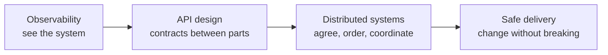
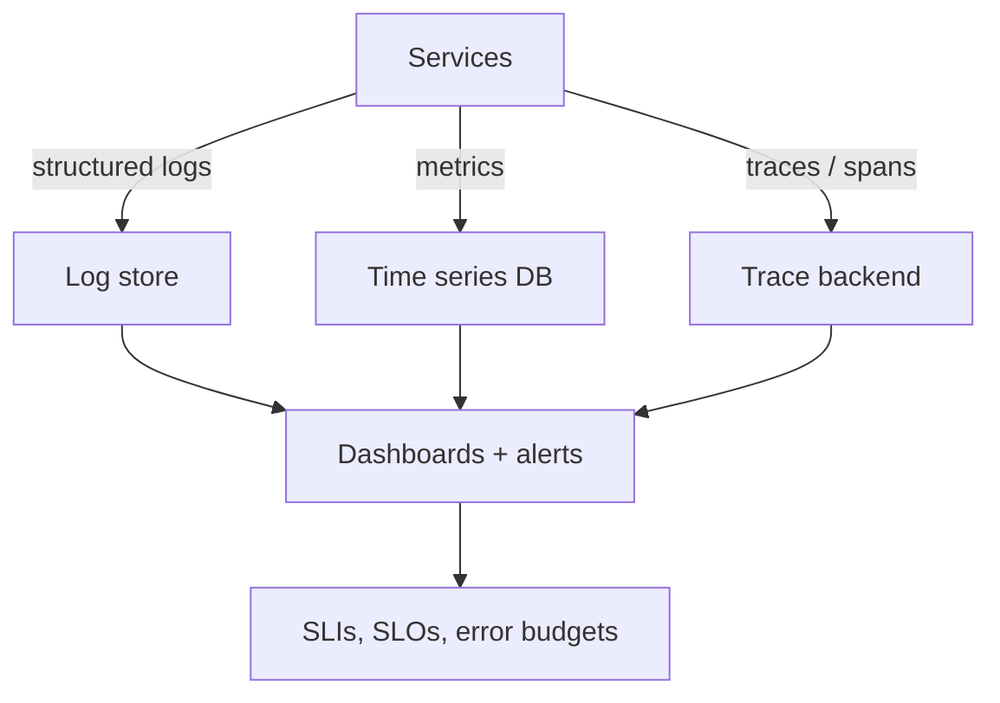
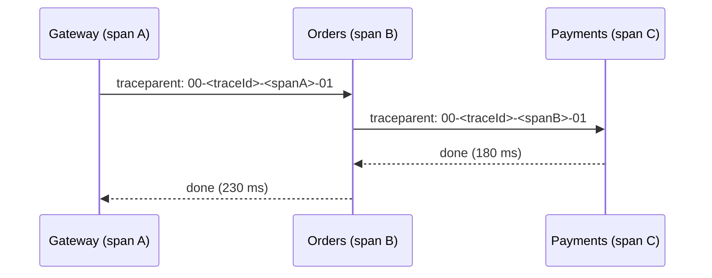
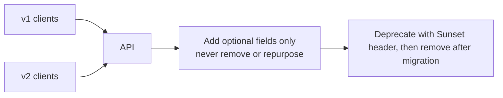
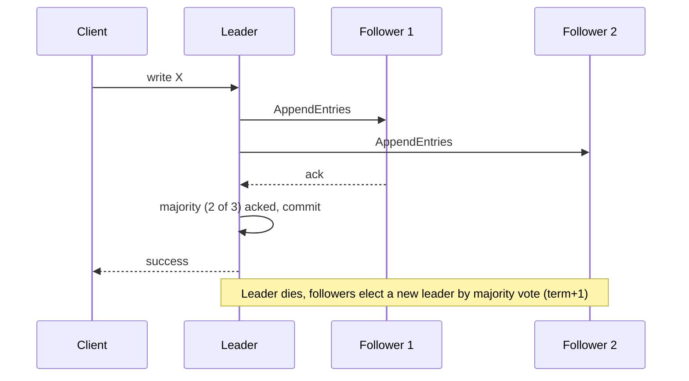
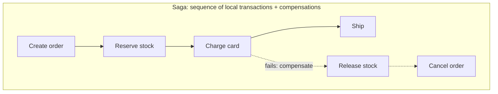
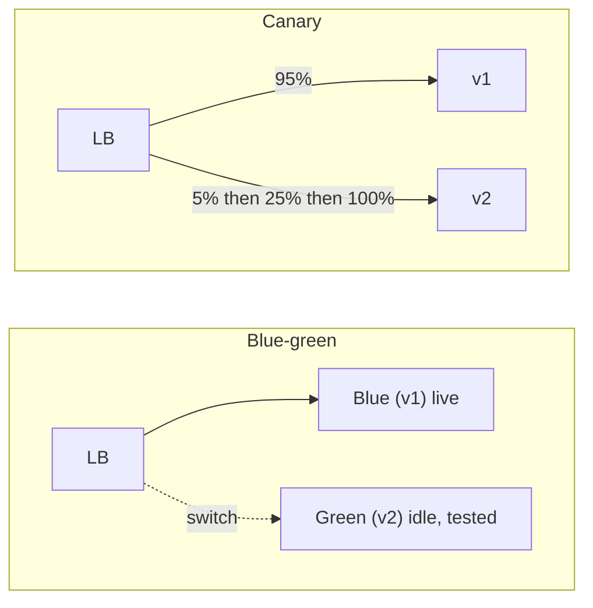

# 05. Distributed Systems, APIs, Observability and Safe Delivery

The cross-cutting fundamentals that tie everything together.

---

## Chapter map



---

## Anchor concept 1: Observability

### 1. Big picture
You cannot operate what you cannot see. Observability lets you ask **new** questions about a running system without shipping new code.

### 2. Structure: three pillars plus SLOs



| Pillar | Answers | Example |
|---|---|---|
| Logs | What happened? | `{"level":"ERROR","orderId":"42","traceId":"abc","msg":"payment declined"}` |
| Metrics | How much / how often? | `http_server_requests_seconds` histogram |
| Traces | Where did time go across services? | Span tree for one request |

### 3. Behaviour: a trace


The same `traceId` flows through every hop (W3C `traceparent`), so one query shows the whole path and which hop is slow.

### 4. Implementation
- Instrument with **OpenTelemetry** (SDK + auto-instrumentation) and export via an OTLP collector.
- Put `traceId` in every log line (MDC in Java; async context in Node).
- Metrics: use the **RED** method for services (Rate, Errors, Duration) and **USE** for resources (Utilization, Saturation, Errors).

### 5. SLO math (worked)

```
SLI: fraction of requests that succeed in < 300 ms
SLO: 99.9% over 30 days
Error budget: 0.1% of ~100M requests = ~100,000 bad requests allowed
Burn rate alert: if budget burns at 14x for 1 hour (2% budget gone), page someone.
```
Policy: when the budget is spent, freeze risky releases and fix reliability.

### 6. Finer details
- Alert on **symptoms** (user-visible SLO burn), not every cause (CPU 80%).
- Beware high-cardinality metric labels (user id as a label explodes cost); put such detail in traces/logs.
- Sample traces smartly (tail-based: keep slow/error traces).
- Never log secrets or PII; mask at the logger.

---

## Anchor concept 2: API design

### 1. Big picture
An API is a long-lived **contract**. Breaking it breaks every client you do not control. Design for evolution first, elegance second.

### 2. Structure: choosing a style

| Style | Strength | Weakness | Use for |
|---|---|---|---|
| REST/JSON | Universal, cacheable, simple tooling | Over/under-fetching | Public and general APIs |
| gRPC (Protobuf) | Fast, typed contracts, streaming | Browser needs proxy; less human-readable | Internal service-to-service |
| GraphQL | Client picks fields, one round trip | Caching, N+1, query-cost control | Diverse frontends |
| Async events (Kafka, webhooks) | Decoupled, push | Ordering, delivery semantics | Integration, notifications |

### 3. Behaviour: safe evolution



### 4. Implementation: idempotency key, errors, pagination

```http
POST /v1/payments
Idempotency-Key: 6b1f1c9e-...        # client-generated, stored server-side for 24h
Content-Type: application/json

HTTP/1.1 429 Too Many Requests
Retry-After: 2
Content-Type: application/problem+json   # RFC 9457
{"type":"https://api.example.com/errors/rate-limit","title":"Too many requests","status":429}

GET /v1/orders?limit=20&cursor=eyJpZCI6MTIzfQ     # opaque cursor, not OFFSET
```

### 5. Trade-offs and details
- **Backward compatible** = adding optional fields/endpoints. **Breaking** = removing/renaming fields, tightening validation, changing semantics.
- Prefer URL or header versioning, but mostly avoid new versions through additive change.
- Define timeouts, payload limits, rate limits and error format in the contract.
- Use correct verbs/status codes: `PUT`, `DELETE` idempotent by definition; `POST` needs an idempotency key.
- Document with OpenAPI; run **contract tests** (Pact) so producers know who they would break.

---

## Anchor concept 3: Distributed systems essentials

### 1. Big picture
Once state or computation spans machines, you lose shared memory, shared clock, and reliable communication. Everything below is a way to cope with that.

### 2. Structure: the "eight fallacies" in one line
The network is not reliable, latency is not zero, bandwidth is not infinite, the network is not secure, topology changes, there are multiple admins, transport has cost, the network is not homogeneous.

### 3. Behaviour: key mechanisms

**Clocks and ordering.** Wall clocks drift; do not use them to order events across machines. Use logical clocks (Lamport), vector clocks, or a single sequencer (DB sequence, Kafka partition offset).

**Consensus (Raft).** A cluster agrees on a log despite failures.


Tolerates `f` failures with `2f + 1` nodes. Used by etcd, Consul, many databases. You typically *use* it (etcd, ZooKeeper) rather than implement it.

**Distributed transactions: 2PC vs Saga.**



| | 2PC | Saga |
|---|---|---|
| Consistency | Atomic, strong | Eventual, via compensation |
| Availability | Blocks if coordinator dies | High |
| Coupling | Needs all participants to support it | Loose |
| Complexity | In the protocol | In your business logic |

### 4. Delivery semantics

| Guarantee | Meaning | Reality |
|---|---|---|
| At-most-once | Maybe lost, never duplicated | Fire and forget |
| At-least-once | Never lost, maybe duplicated | Default in brokers; **make consumers idempotent** |
| Exactly-once | Processed once | Achieved as at-least-once + idempotent/transactional processing; true exactly-once delivery over a network is not possible |

### 5. Trade-offs and details
- Leader election needs a quorum; an even number of nodes adds cost without extra fault tolerance (use 3 or 5).
- **Fencing tokens** stop a stale leader from corrupting data after a pause.
- Prefer designs where you **avoid** distributed transactions (aggregate boundaries, single-writer per entity).
- Partial failure is the norm: a timeout does not tell you whether the operation happened. Design operations to be safely retryable.

---

## Anchor concept 4: Deployment safety

### 1. Big picture
Most outages are caused by change. Make change small, reversible, gradual, and observable.

### 2. Structure and behaviour: strategies



| Strategy | Rollback | Cost | Risk exposure |
|---|---|---|---|
| Rolling | Slow (roll forward/back) | Low | Medium |
| Blue-green | Instant (flip back) | 2x capacity during switch | All-at-once cutover |
| Canary | Fast (route to 0%) | Low | Small, measured by metrics |
| Feature flags | Instant, per feature | Flag hygiene | Decouples deploy from release |

### 3. Implementation notes
- Automate promotion/rollback on SLO signals (Argo Rollouts, Flagger, cloud deploy tools).
- **Database changes: expand/contract.** (1) add new column nullable, (2) deploy code writing both, (3) backfill, (4) deploy code reading new, (5) drop old. Never couple a destructive migration with the code release.
- Infrastructure as Code in version control, same review and pipeline as app code.

### 4. Finer details
- Old and new versions run **simultaneously**: messages, APIs and schemas must be compatible both ways.
- Remove stale feature flags; they are hidden technical debt.
- Practice rollback; a rollback path never exercised often fails.

---

## Concept map: other cross-cutting topics

| Concept | What | Note |
|---|---|---|
| Event sourcing | Store events, derive state | Perfect audit, replay; complex queries and schema evolution |
| CQRS | Separate write and read models | Scales reads independently; eventual consistency |
| Idempotency | Same request twice = same effect | Required wherever retries or at-least-once exist |
| Service discovery | Find healthy instances | DNS, Kubernetes services, Consul |
| Gossip / membership | Spread cluster state without a coordinator | Used by Cassandra, Consul; eventually consistent |
| Capacity planning | Predict resource needs | Revisit quarterly; test limits (chapter 01 recipe) |
| ADRs | Record why decisions were made | Future you will thank present you |

## Self-check
1. Draw the trace for a request touching 3 services. What does it reveal that logs alone would not?
2. You must remove a column. Write the five deployment steps in order.
3. Explain why "exactly-once delivery" is really "at-least-once plus idempotency".
