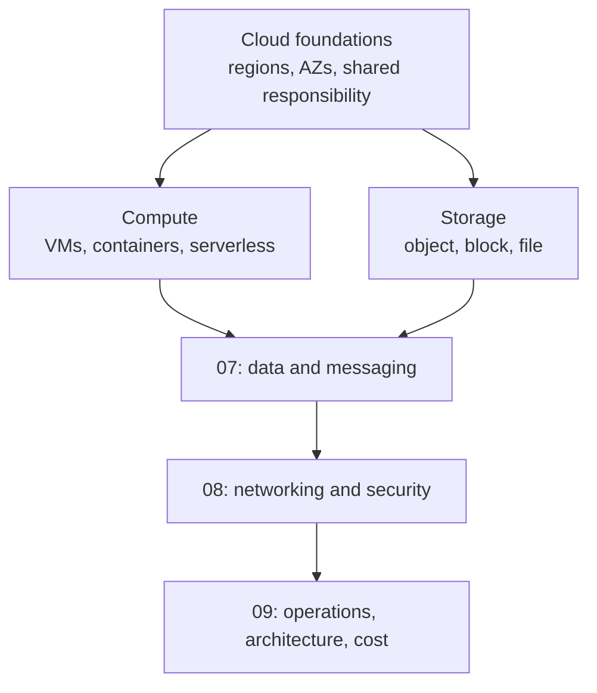
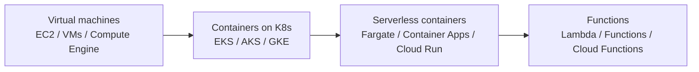
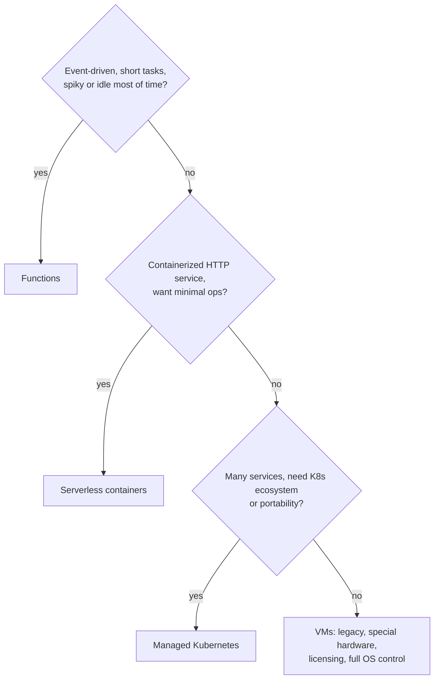
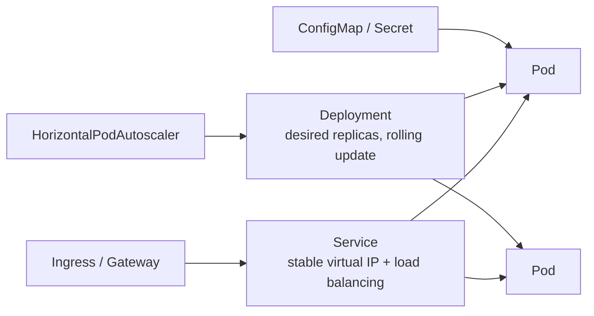
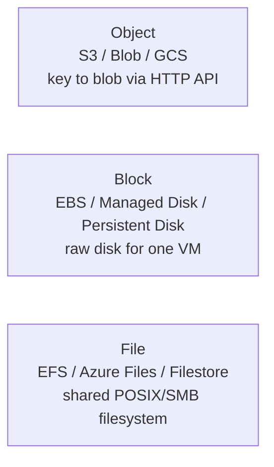
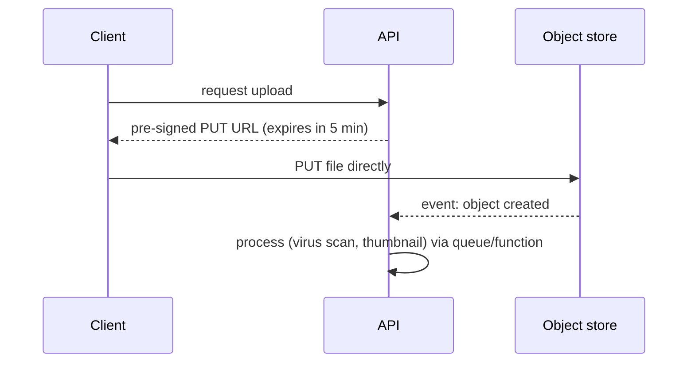

# 06. Cloud Core: Compute and Storage

Cloud services are the **building blocks** that realize the principles from chapters 02 to 05. Learn each block as: what problem it solves, how it is structured, how it behaves, how to use it, what it costs you.

---

## Chapter map



---

## Anchor concept 1: The compute spectrum

### 1. Big picture
Compute options form a spectrum: more **control** on one end, more **abstraction** (less ops) on the other.


Left: you manage OS, patching, scaling. Right: provider manages them; you pay per use; you accept limits.

### 2. Structure: decision flow



### 3. Behaviour of each

| Model | Scaling | Startup | Billing | Max run time |
|---|---|---|---|---|
| VM | Autoscaling group, minutes | 30 s to minutes | Per second/hour while running | Unlimited |
| Kubernetes | HPA (pods) + cluster autoscaler (nodes) | Seconds (pod), minutes (node) | Underlying nodes | Unlimited |
| Serverless containers | Per request/CPU, scale to zero | Seconds | Per vCPU-second | Provider limit |
| Functions | Per event, scale to zero | Cold start 100 ms to seconds | Per invocation + GB-second | e.g. 15 min |

### 4. Implementation: Kubernetes structure in one view



```yaml
apiVersion: apps/v1
kind: Deployment
metadata: { name: orders }
spec:
  replicas: 3
  strategy: { type: RollingUpdate, rollingUpdate: { maxUnavailable: 0, maxSurge: 1 } }
  template:
    spec:
      topologySpreadConstraints:             # spread across AZs
        - { maxSkew: 1, topologyKey: topology.kubernetes.io/zone, whenUnsatisfiable: DoNotSchedule,
            labelSelector: { matchLabels: { app: orders } } }
      containers:
        - name: orders
          image: registry.example.com/orders:1.4.2
          resources: { requests: { cpu: 250m, memory: 512Mi }, limits: { memory: 512Mi } }
          readinessProbe: { httpGet: { path: /ready, port: 8080 } }
          livenessProbe:  { httpGet: { path: /live,  port: 8080 } }
          securityContext: { runAsNonRoot: true, readOnlyRootFilesystem: true }
```

### 5. Trade-offs

| Option | Wins | Loses |
|---|---|---|
| VMs | Full control, predictable, licensing | Patching, slow scaling, idle waste |
| Kubernetes | Portability, rich ecosystem, bin-packing | Steep learning curve, operational surface |
| Serverless containers | Low ops, scale to zero | Less control, per-request limits |
| Functions | Zero idle cost, event glue | Cold starts, timeouts, concurrency limits, vendor coupling, hard to debug locally |

### 6. Finer details
- **Spot / preemptible** instances: 60 to 90% cheaper but can vanish with ~2 min notice. Great for stateless/batch, with checkpointing.
- **Cold starts**: mitigate with provisioned concurrency, smaller packages, lighter runtimes (or SnapStart-like features for JVM).
- **Concurrency limits**: a function scaling to thousands can overwhelm a database; put a queue or reserved concurrency between them.
- Set CPU/memory **requests** accurately (scheduling) and a **memory limit** (avoid noisy neighbours); CPU limits often cause throttling, so measure first.
- Container images: small base, pinned digest, scanned, non-root.

---

## Anchor concept 2: Storage types

### 1. Big picture
Three storage shapes, each matched to an access pattern.



### 2. Structure and behaviour

| | Object | Block | File |
|---|---|---|---|
| Access | HTTP API, whole-object | Mounted device, random IO | NFS/SMB, shared mount |
| Sharing | Unlimited clients | Typically one instance | Many instances |
| Latency | Tens of ms | Sub-ms to ms | ms |
| Scale | Practically unlimited | TB-scale volume | PB-scale, elastic |
| Cost/GB | Lowest | Medium | Highest |
| Typical use | Media, backups, data lake, static sites | Databases, boot disks | Shared content, legacy apps, CMS |

### 3. Implementation: object storage patterns


Direct-to-storage uploads keep large bytes off your app servers.

**Lifecycle policy example:** hot (Standard) for 30 days -> Infrequent Access for 90 days -> Archive (Glacier/Archive tier) -> delete after 7 years. Cuts cost 70%+ for cold data.

### 4. Durability vs availability (often confused)

| Term | Meaning | Example |
|---|---|---|
| Durability | Probability data is **not lost** | "11 nines" = 99.999999999%/yr: lose 1 object in 10 million every 10,000 years |
| Availability | Probability you can **access** it now | Standard object storage typically 99.9 to 99.99% |

Replication classes: **LRS** (3 copies in one datacenter), **ZRS** (across AZs), **GRS** (across regions, async). Higher = more durable, more cost, and async cross-region copy means RPO > 0.

### 5. Trade-offs and details
- Object stores are **not filesystems**: no append/rename atomicity, listing is eventually costly; design keys with high-cardinality prefixes if the provider documents partition limits.
- Block volumes are AZ-bound; snapshot to move or back up. Provisioned IOPS/throughput is a separate (billable) dial.
- Versioning + object lock (WORM) protects against deletion and ransomware.
- Egress (data leaving the cloud or region) is the hidden cost; keep compute near data.
- Block `gp3`-style volumes let you tune IOPS independent of size; know your database's real IOPS need before paying for premium tiers.

---

## Concept map: other compute/storage topics

| Concept | What | Note |
|---|---|---|
| Autoscaling groups | Replace/scale VMs from a template | Use health checks, multiple AZs, scale on queue depth or RPS |
| Placement strategies | Spread vs cluster instances | Spread for HA, cluster for low-latency HPC |
| Batch / HPC | Queued jobs on ephemeral fleets (AWS Batch, Azure Batch) | Use spot + retry |
| Machine images / golden images | Pre-baked VM image | Faster boot, immutable infrastructure |
| Instance families | General, compute-, memory-, storage-optimized, GPU, ARM | ARM (Graviton/Ampere) often ~20% cheaper per performance |
| Ephemeral / instance store | Fast local disk lost on stop | Cache and scratch only |
| Snapshots and backups | Point-in-time copies | Automate, copy cross-account/region, test restore |
| Archive tiers | Cheapest storage, slow retrieval (minutes to hours) | Retrieval fees and minimum retention |

## Self-check
1. A function triggered by a queue scales to 1,000 concurrent invocations and the database falls over. Name two fixes.
2. Why can't you mount one standard block volume on 20 web servers? What do you use instead?
3. Object storage has 11 nines durability. Why do you still need versioning and backups?
