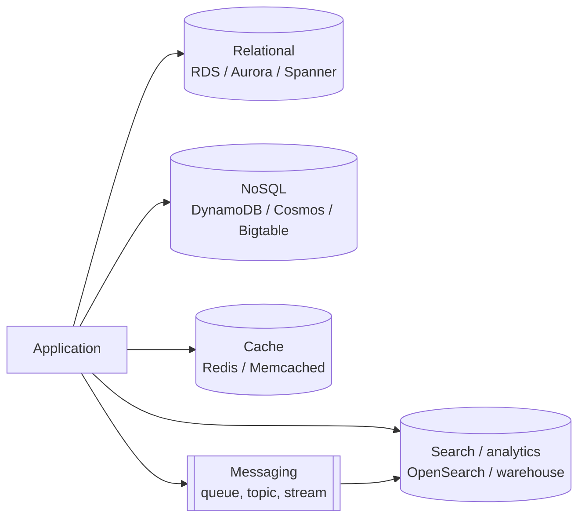
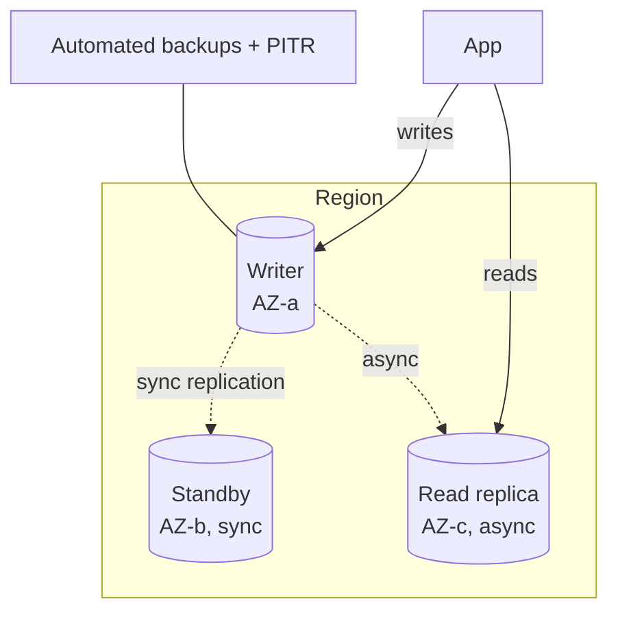
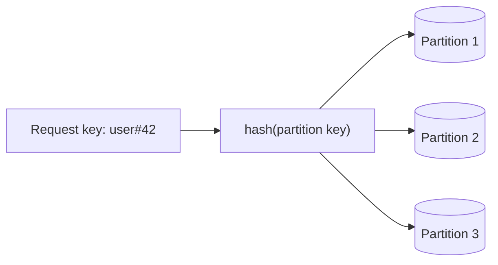
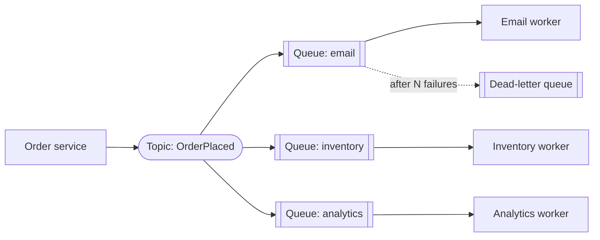
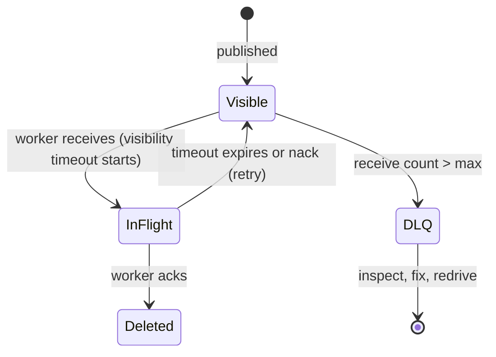
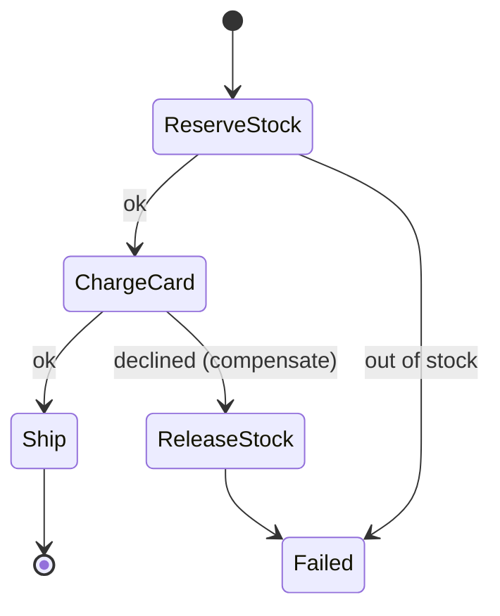

# 07. Cloud Core: Data and Messaging

---

## Chapter map



Rule of thumb: start with **one relational database**, add specialized stores only when a measured need justifies the extra operational cost.

---

## Anchor concept 1: Managed relational databases

### 1. Big picture
Provider runs backups, patching, failover, replication; you keep schema, queries and tuning. Choose when you need transactions, joins, ad-hoc queries.

### 2. Structure



### 3. Behaviour: failover
Primary fails -> health monitor detects -> standby promoted -> DNS endpoint flips -> apps reconnect (typically 30 to 120 s). Connections drop; apps must **retry and re-resolve DNS**.

### 4. Implementation notes
- Enable Multi-AZ for production; read replicas for read scale or reporting (not as HA).
- Use a connection proxy (RDS Proxy, PgBouncer) with serverless/functions.
- Parameter groups, encryption with CMK, TLS enforced, no public access, private subnets.
- **Aurora/Spanner-style** distributed storage: faster failover and replicas, higher cost; Spanner adds global strong consistency.

### 5. Trade-offs

| Choice | Gain | Cost |
|---|---|---|
| Multi-AZ sync standby | Zero data loss on AZ failure | Write latency, 2x cost |
| Read replicas | Read scale | Lag, stale reads |
| Cross-region replica | DR, local reads | Async RPO, egress cost |
| Serverless DB (Aurora Serverless etc.) | Scales to demand | Cold resume, cost at steady load |

### 6. Finer details
Test **failover** and **point-in-time restore** quarterly. Watch replica lag, connection count, and storage autoscaling limits. Major version upgrades need planning and a rollback story.

---

## Anchor concept 2: NoSQL and partition-key design

### 1. Big picture
NoSQL stores trade query flexibility for **predictable performance at massive scale** by distributing data across partitions by key.

| Family | Examples | Fits |
|---|---|---|
| Key-value | DynamoDB, Redis | Sessions, carts, lookups |
| Document | Cosmos DB (core), Firestore, MongoDB | Flexible-schema entities |
| Wide-column | Bigtable, Cassandra | Time series, huge write throughput |
| Graph | Neptune, Cosmos Gremlin | Relationship traversal |

### 2. Structure: how requests find data



### 3. Behaviour: design from access patterns, not entities
You design the table **around the queries** and denormalize.

```
Access patterns:  (1) get user by id   (2) list a user's orders newest first   (3) get order by id
Single-table design (DynamoDB style):
  PK            SK                    attributes
  USER#42       PROFILE               name, email
  USER#42       ORDER#2026-10-23#9001 total, status     <- query PK=USER#42, SK begins_with ORDER#, descending
  ORDER#9001    META                  userId, items     <- GSI or direct get
```

### 4. Implementation example (Node, DynamoDB)

```js
const res = await ddb.send(new QueryCommand({
  TableName: 'app',
  KeyConditionExpression: 'PK = :pk AND begins_with(SK, :sk)',
  ExpressionAttributeValues: { ':pk': 'USER#42', ':sk': 'ORDER#' },
  ScanIndexForward: false,           // newest first
  Limit: 20,
}));
```

### 5. Trade-offs

| Gain | Cost |
|---|---|
| Single-digit ms at any scale, serverless capacity | No ad-hoc joins/queries; new access pattern may need new index or data migration |
| Built-in multi-AZ replication | Eventual consistency by default (opt into strong reads at higher cost) |

### 6. Finer details
- **Hot partition**: a key with disproportionate traffic (celebrity, `status=ACTIVE`) throttles. Choose high-cardinality keys; add write-sharding suffixes (`KEY#0..9`).
- Capacity modes: on-demand (spiky, unknown) vs provisioned (steady, cheaper with autoscaling).
- Scans are a smell. Item size limits (e.g. 400 KB) push big blobs to object storage.
- TTL attributes for automatic expiry; streams/change-feeds for event publishing and outbox-like patterns.

---

## Anchor concept 3: Messaging: queues vs topics vs streams

### 1. Big picture
Messaging decouples producers from consumers in **time**, **scale** and **failure**. Three different tools:

| Type | Model | Examples | Consumers | Retention | Use |
|---|---|---|---|---|---|
| **Queue** | Point-to-point; each message handled by one worker | SQS, Service Bus queue | Competing workers | Until consumed | Work distribution, load leveling |
| **Topic / pub-sub** | Fan-out; every subscriber gets a copy | SNS, Service Bus topic, Pub/Sub | Many independent | Short | Notifications, event broadcast |
| **Stream / log** | Ordered, replayable append-only log | Kafka, Kinesis, Event Hubs | Many, each tracks offset | Days to forever | Event sourcing, analytics, CDC |

### 2. Structure: fan-out with queues per consumer


Each consumer gets its own queue: independent speed, independent retries, one failing consumer cannot block others.

### 3. Behaviour: queue message lifecycle



### 4. Implementation: a safe consumer

```js
for await (const msg of poll(queue)) {
  try {
    if (await alreadyProcessed(msg.id)) { await ack(msg); continue; }   // idempotency
    await handle(JSON.parse(msg.body));
    await markProcessed(msg.id);                                        // same txn as side effect if possible
    await ack(msg);
  } catch (e) {
    if (isPermanent(e)) await sendToDlq(msg); else /* let visibility timeout retry */ void 0;
  }
}
```
Set visibility timeout > worst-case processing time; extend it (heartbeat) for long jobs.

### 5. Trade-offs

| Need | Pick | Watch out |
|---|---|---|
| Strict ordering | FIFO queue / single Kafka partition key | Throughput limited per group/partition |
| Replay, multiple readers, big throughput | Stream (Kafka) | Operational weight; consumer lag; partition count fixed-ish |
| Simple async work | Standard queue | At-least-once, **no** ordering guarantee |
| Broadcast | Topic + queue per subscriber | Subscription filtering and cost |

### 6. Finer details
- **Poison messages** loop forever without a DLQ and max-receive limit. Alert on DLQ depth > 0.
- Ordering across partitions does not exist; use an entity id as the partition key to order per entity.
- Message size limits (e.g. 256 KB): send a pointer to object storage (claim-check pattern).
- Consumer lag is the key stream metric; autoscale consumers on lag.
- Schema evolution: use a registry (Avro/Protobuf) with compatibility rules.

---

## Anchor concept 4: Workflow orchestration

### 1. Big picture
When a business process spans many steps, retries, waits and compensations, a **state machine service** (Step Functions, Logic Apps/Durable Functions, Google Workflows, Temporal) makes the flow explicit, durable and observable instead of scattering it across queues.

### 2. Structure and behaviour



### 3. Trade-offs
- **Orchestration** (central brain, easy to see/debug) vs **choreography** (services react to events, loosely coupled but flow is implicit). Use orchestration for complex, business-critical flows; choreography for simple fan-out.
- Pay per state transition; keep payloads small; make each step idempotent.

---

## Concept map: other data topics

| Concept | What | Note |
|---|---|---|
| Cache services (ElastiCache, Azure Cache, Memorystore) | Managed Redis/Memcached | Redis for data structures, persistence, pub/sub; Memcached for simple multi-threaded caching |
| Data warehouse (Redshift, Synapse, BigQuery) | Columnar, analytical SQL | Separate from OLTP; load via ELT/CDC; per-query or per-node pricing |
| Data lake (object store + Parquet + catalog) | Cheap raw + curated data | Governance and partitioning decide usability |
| Search (OpenSearch, Elasticsearch) | Full-text, relevance, aggregations | A *secondary* index, not your system of record |
| CDC (change data capture) | Stream DB changes | Debezium, DMS; feeds search, caches, analytics |
| Time-series DBs | Metrics, IoT | Retention and downsampling policies |
| OLTP vs OLAP | Transactions vs analytics | Don't run heavy analytics on the primary |
| Backup/PITR | Restore to any second | Test restores |

## Self-check
1. Why give each subscriber its own queue behind a topic?
2. Design DynamoDB keys for "recent 20 messages in a chat room" and say where a hot partition could appear.
3. A message fails 5 times, then what? Trace it through the state diagram.
