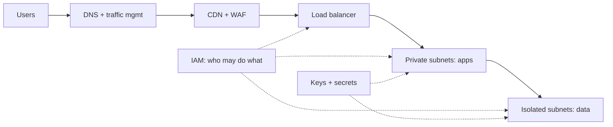
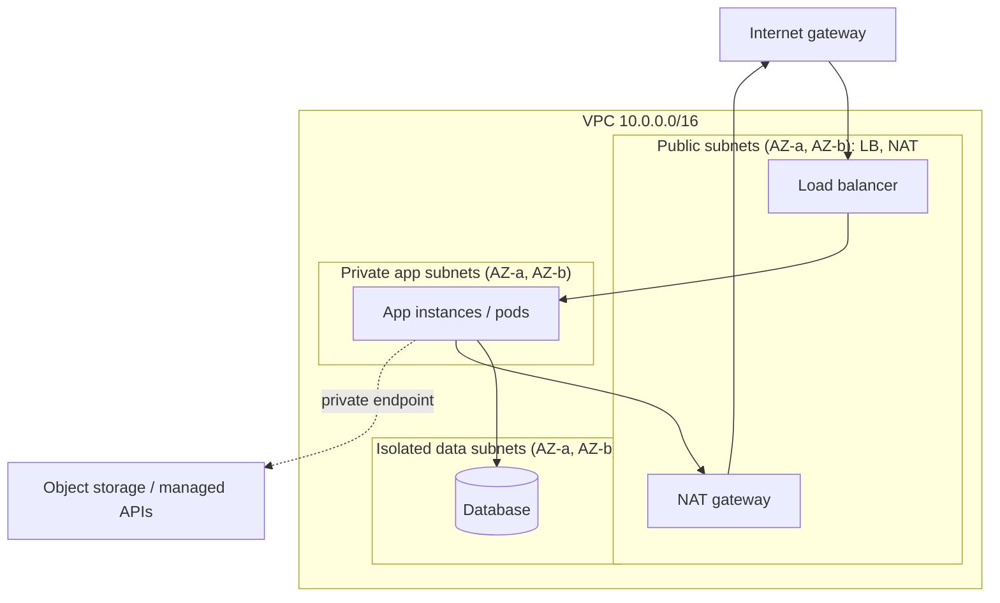
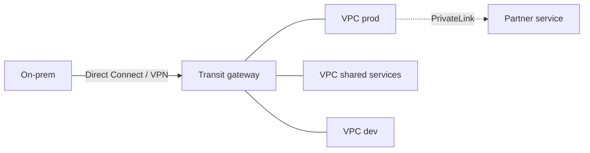
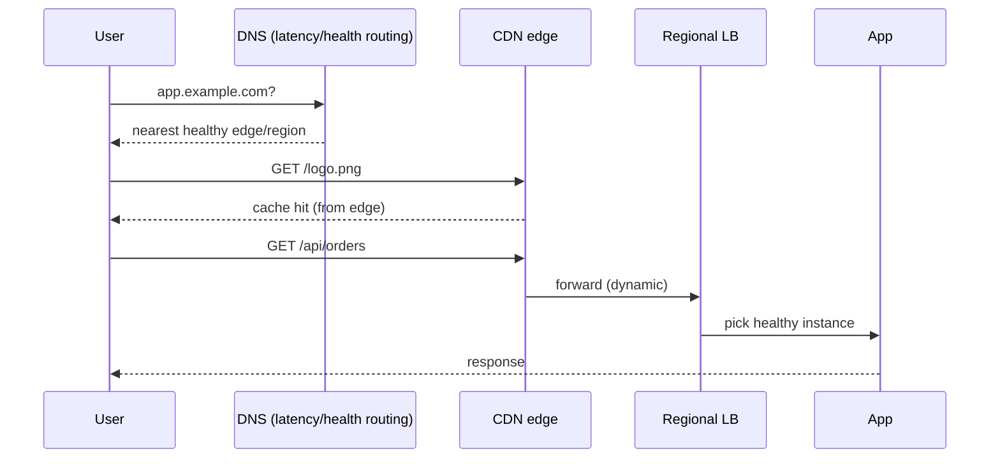
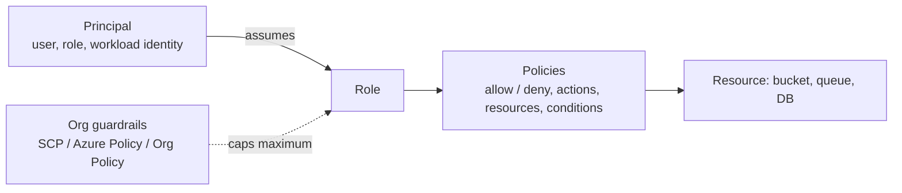
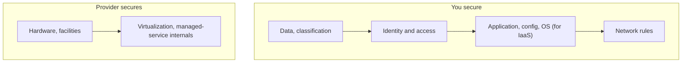

# 08. Cloud Core: Networking, Identity and Security

---

## Chapter map



---

## Anchor concept 1: Virtual network design (VPC / VNet)

### 1. Big picture
A VPC is your private, isolated network in the cloud. Design it so the internet can reach **only** what must be public, and everything else sits in private tiers.

### 2. Structure: standard three-tier, multi-AZ layout



| Element | Purpose |
|---|---|
| CIDR block | Address range; plan for growth and **avoid overlap** with other VPCs/on-prem (peering needs non-overlapping) |
| Public subnet | Has route to internet gateway; hosts only LB/NAT/bastion alternatives |
| Private subnet | No inbound from internet; outbound via NAT |
| Route tables | Decide where packets go |
| NAT gateway | Outbound internet for private subnets (per-AZ for HA; costs per hour + GB) |
| Security group (SG) | **Stateful**, instance-level allow-rules; reference other SGs instead of IPs |
| NACL | **Stateless**, subnet-level allow/deny; coarse backstop |

### 3. Behaviour: how a request flows
Internet -> IGW -> public LB (SG allows 443 from anywhere) -> app (SG allows 8080 **only from LB's SG**) -> DB (SG allows 5432 **only from app's SG**). Return traffic is automatically allowed (stateful). App calling an external API goes out through NAT.

### 4. Implementation (Terraform sketch)

```hcl
resource "aws_security_group_rule" "db_from_app" {
  type                     = "ingress"
  security_group_id        = aws_security_group.db.id
  source_security_group_id = aws_security_group.app.id   # identity-based, not IP-based
  from_port = 5432
  to_port   = 5432
  protocol  = "tcp"
}
```

### 5. Trade-offs and details
- NAT gateways are a notable cost; use **VPC/private endpoints** (gateway endpoints for S3/DynamoDB are free) to keep traffic off the internet and cut NAT charges.
- One NAT per AZ avoids cross-AZ failure and cross-AZ data charges, at higher hourly cost.
- Cross-AZ traffic is billed in most providers; keep chatty tiers in the same AZ when possible while still spanning AZs for HA.
- Leave spare CIDR space; resizing a VPC later is painful. IPv6 reduces NAT needs.

---

## Anchor concept 2: Connectivity options

### 1. Big picture
How networks reach each other: VPC to VPC, cloud to on-prem, cloud to SaaS.

### 2. Structure

| Option | Description | Use |
|---|---|---|
| VPC peering | 1:1 private link, non-transitive | A few VPCs |
| Transit gateway / vWAN / NCC | Hub-and-spoke router | Many VPCs + on-prem |
| Site-to-site VPN | Encrypted over the internet, quick to set up | Start / backup path |
| Direct Connect / ExpressRoute / Interconnect | Dedicated private circuit | Stable latency, high bandwidth |
| PrivateLink / Private Endpoint | Expose or consume **one service** privately, no full network peering | SaaS, cross-account APIs |



### 3. Trade-offs
Peering is simple but does not scale (n x (n-1)/2 links). PrivateLink avoids CIDR-overlap problems and limits exposure to a single service. Dedicated circuits take weeks to provision, so keep a VPN as backup.

---

## Anchor concept 3: Load balancing, DNS and CDN

### 1. Big picture
Three tools that put traffic in the right place: **DNS** chooses a region/endpoint, a **CDN** serves cached content near users, a **load balancer** chooses an instance.

### 2. Structure and behaviour



| Load balancer | Layer | Features |
|---|---|---|
| Network LB | L4 | Ultra-fast, static IPs, TLS passthrough/termination |
| Application LB | L7 | Path/host routing, headers, WAF integration, auth actions |
| Global LB / Front Door / Global Accelerator | L7/L4 anycast | Multi-region routing and failover over provider backbone |

| DNS routing policy | Behaviour |
|---|---|
| Simple | One answer |
| Weighted | Split traffic (canary, migration) |
| Latency | Route to lowest-latency region |
| Geolocation / geoproximity | Data residency, regional content |
| Failover | Primary/secondary based on health checks |

### 3. Finer details
- **TTL matters**: failover through DNS is only as fast as clients and resolvers honor a low TTL (and many do not). Anycast global load balancers fail over faster.
- Health checks should test something meaningful but cheap; deregistration delay lets in-flight requests finish.
- CDN: set `Cache-Control` precisely; use versioned asset URLs (`app.3f9a.js`) so you never need purges; enable origin shield; consider signed URLs/cookies for private content.
- WAF: managed rule sets (OWASP), rate-based rules, bot control. Start in count/monitor mode before blocking.
- API gateway / service mesh: throttling, auth, request validation, mTLS, retries, traffic shifting.

---

## Anchor concept 4: Identity and access management (IAM)

### 1. Big picture
IAM answers **who** (principal) can do **what** (action) on **which** resource under **which conditions**. Misconfigured IAM is the most common root cause of cloud breaches.

### 2. Structure



### 3. Behaviour: evaluation logic (simplified, AWS-like)
1. Start with **implicit deny**.
2. Any **explicit deny** anywhere (policy, boundary, org guardrail) wins.
3. Otherwise, an **allow** must exist in every applicable layer (identity policy, resource policy as applicable, permission boundary, SCP).

### 4. Implementation: least-privilege policy and workload identity

```json
{
  "Version": "2012-10-17",
  "Statement": [{
    "Effect": "Allow",
    "Action": ["s3:GetObject", "s3:PutObject"],
    "Resource": "arn:aws:s3:::acme-uploads/tenant-${aws:PrincipalTag/tenant}/*",
    "Condition": { "Bool": { "aws:SecureTransport": "true" } }
  }]
}
```
- Workloads use **roles, never long-lived keys**: IAM roles for service accounts (IRSA / EKS Pod Identity), Azure managed identity, GCP workload identity federation.
- Humans: SSO via IdP (SAML/OIDC), MFA, short sessions, break-glass account with alerting.
- CI/CD authenticates via **OIDC federation**, not stored secrets.

### 5. Trade-offs and details
- Start broad in dev, but **tighten using access-analysis tools** (last-used data, policy generation from CloudTrail) before production.
- Avoid wildcard `*` on actions/resources; split read vs write vs admin roles.
- Separate accounts/subscriptions/projects per environment and per team: they are the strongest isolation boundary (blast radius, billing, quotas).

---

## Anchor concept 5: Shared responsibility, secrets, governance

### 1. Big picture


More managed = provider takes more layers (Lambda < containers < VMs in your duties), but **data, identity and configuration are always yours**.

### 2. Secrets and keys
- Secret store (Secrets Manager / Key Vault / Secret Manager): versioned, audited, auto-rotated, fetched at runtime via IAM, never baked into images or env files in git.
- KMS/HSM: key policies, rotation, grants, separate key per data domain.

### 3. Governance and compliance
- **Landing zone / organization**: multi-account structure, central logging account, baseline guardrails (deny disabling logs, deny public buckets, region allow-list).
- **Audit trail**: CloudTrail / Activity Log / Cloud Audit Logs, immutable, centralized, alerts on privileged actions.
- **Posture management**: CSPM tools (Security Hub, Defender for Cloud, SCC) continuously flag misconfigurations.
- **Data residency**: restrict regions by policy; confirm that replicas, backups, and logs stay in-region.

---

## Concept map: other networking and security topics

| Concept | What | Note |
|---|---|---|
| Service mesh | Sidecar/ambient proxies for mTLS, retries, telemetry | Powerful, adds latency and ops; adopt when you have many services |
| Bastion / session manager | Admin access without open SSH | Prefer SSM/Bastion service with audit over public SSH |
| DDoS protection | Absorb volumetric attacks | Shield / Front Door / Cloud Armor; design for scale-out |
| Egress control | Restrict outbound destinations | Firewall + proxy allow-lists; stops exfiltration and SSRF pivots |
| Private DNS | Internal name resolution | Split-horizon; endpoints resolve to private IPs |
| IPv6 | Plentiful addresses, no NAT | Dual-stack migration; egress-only gateways |
| Zero trust access | Identity-aware proxy instead of VPN | BeyondCorp, Verified Access, Entra Private Access |

## Self-check
1. Draw SG rules for LB, app, DB so that nothing but the LB faces the internet.
2. Why can an explicit deny in a guardrail override an admin's allow?
3. Your private subnet's NAT bill is huge, mostly to object storage. What do you change?
