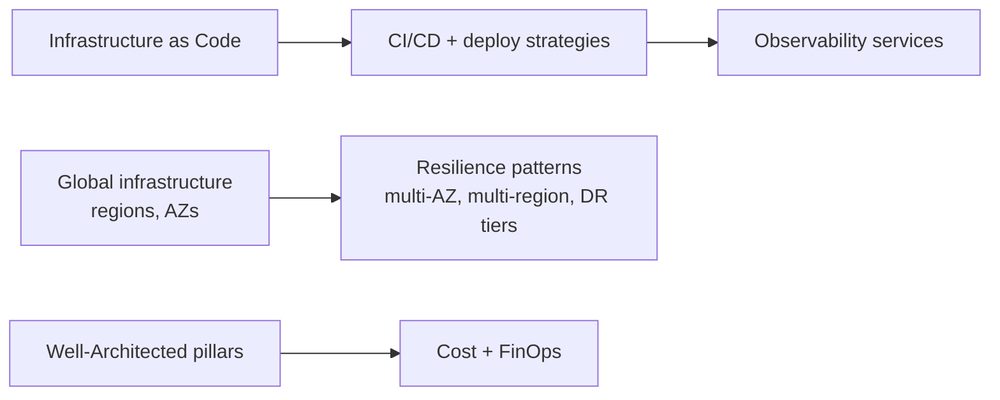
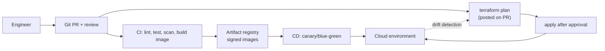
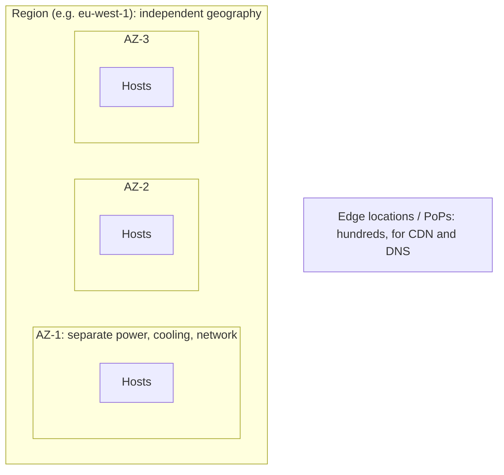
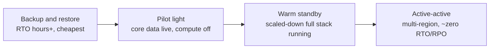
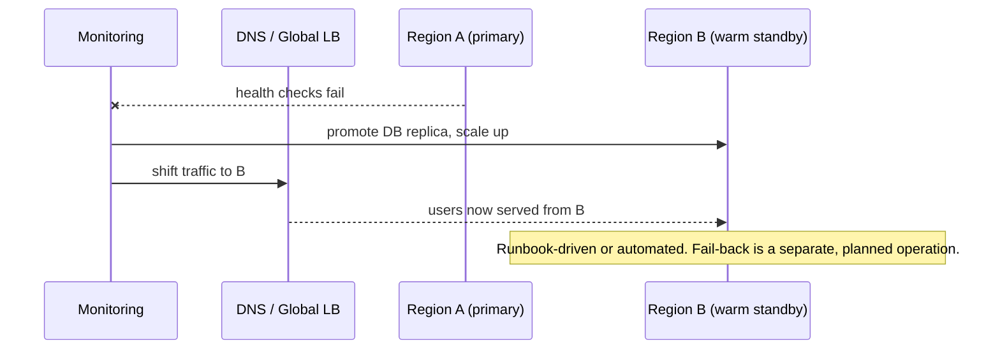
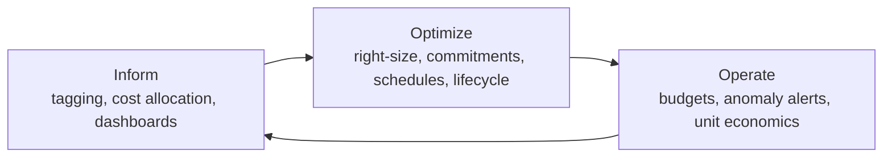

# 09. Cloud Operations, Architecture and Cost

---

## Chapter map

---

## Anchor concept 1: Infrastructure as Code and CI/CD

### 1. Big picture
Infrastructure defined in code is reviewable, repeatable, testable and recoverable. Manual console changes create drift and unrepeatable environments.

### 2. Structure

| Tool | Notes |
|---|---|
| Terraform / OpenTofu | Multi-cloud, declarative, state file (store remotely with locking!) |
| CloudFormation / CDK | AWS-native; CDK uses real languages |
| Bicep / ARM | Azure-native |
| Pulumi | General-purpose languages, multi-cloud |
| Crossplane / Config Connector | Manage cloud resources through Kubernetes APIs |

### 3. Behaviour: declarative reconcile
Desired state (code) vs actual state (cloud) -> **plan** shows the diff -> **apply** converges. Drift detection alerts when someone changed things by hand.

### 4. Implementation practices
- Modules for reusable patterns (network, service, database); pin module versions.
- Separate state per environment/component to limit blast radius; remote state with locking (S3+DynamoDB, Azure Storage, GCS).
- Policy as code (OPA/Conftest, Checkov, Sentinel) in the pipeline: deny public buckets, unencrypted volumes.
- **Immutable infrastructure**: replace, don't patch in place. Bake an image/container, roll out, discard the old.
- Pipeline credentials via OIDC federation; least privilege per pipeline; protect the main branch and apply step.

### 5. Trade-offs and details
- Stateful resources (databases) need `prevent_destroy` and careful renames: a rename can mean destroy+create.
- Secrets can leak into state files; encrypt state and restrict access.
- Keep environments structurally identical, differing only in size/count.

---

## Anchor concept 2: Regions, availability zones and failure domains

### 1. Big picture
Failure comes at different scales. Pick the **failure domain** you must survive, and span at least that.

| Failure | Blast radius | Protect with |
|---|---|---|
| Instance / disk | One node | Replicas, autoscaling |
| Rack / host group | Few nodes | Spread placement |
| Availability zone | One datacenter group | **Multi-AZ** (default for production) |
| Region | Whole geography | **Multi-region** (only if business needs it) |
| Provider-wide / account compromise | Everything | Multi-account isolation, backups elsewhere, (multi-cloud, rarely) |

### 2. Behaviour and finer details
- Multi-AZ is usually near-free in complexity (managed services do it); **multi-region is a different league**: data replication, conflict handling, routing, double the cost, regular failover drills.
- Many global services have a **control plane in one region** (e.g. IAM, DNS changes). Design DR so the *data plane* keeps working without control-plane calls.
- Capacity: after losing one AZ of 3, the remaining two must absorb the load (size at N+1 AZ, i.e. 150% of needed capacity across 3 AZs).
- Data residency/sovereignty may dictate regions; latency may dictate more.

---

## Anchor concept 3: Disaster recovery tiers

### 1. Big picture
Choose DR by business impact (RPO/RTO from chapter 03), not by default.

### 2. Structure

### 3. Behaviour: warm standby failover

### 4. Finer details
Rehearse (game days). Know the data-loss window (replication lag = real RPO). Fail-back is harder than failover: plan reverse replication. Keep DR config (IaC) ready and quotas/limits pre-raised in the DR region.

---

## Anchor concept 4: Well-Architected pillars as a review lens

| Pillar | Core question | Example practice |
|---|---|---|
| Operational excellence | Can we run, observe and change it safely? | IaC, runbooks, postmortems |
| Security | Is data and identity protected? | Least privilege, encryption, detection |
| Reliability | Does it recover and meet SLOs? | Multi-AZ, retries, tested backups |
| Performance efficiency | Right resource for the job? | Right-sizing, caching, load tests |
| Cost optimization | Are we paying only for value? | Tagging, commitments, deleting idle |
| Sustainability | Minimize resource waste | Efficient instances, utilization targets |

Use it as a **checklist in design reviews**, scored per workload, with a prioritized remediation list. Each cloud publishes its own framework (AWS Well-Architected, Azure WAF, Google Cloud Architecture Framework); the pillars are near-identical.

---

## Anchor concept 5: Cost and FinOps

### 1. Big picture
Cloud turns capital expense into variable operating expense. Cost becomes an **architectural quality attribute** that engineers own.

### 2. Structure: pricing models

| Model | Discount vs on-demand | Commitment | Best for |
|---|---|---|---|
| On-demand | 0% | None | Spiky, unknown, new workloads |
| Reserved / Savings Plans / CUDs | ~30 to 70% | 1 to 3 years, spend or instance based | Steady baseline |
| Spot / preemptible | ~60 to 90% | None, can be reclaimed | Stateless, batch, CI, fault-tolerant |
| Free tier / serverless | n/a | None | Low or bursty usage |

### 3. Behaviour: where the money actually goes
Typical top line items: compute, **data egress / cross-AZ transfer**, NAT gateways, managed database instances and IOPS, log ingestion/retention, idle resources (unattached volumes, forgotten environments), over-provisioned instances.

### 4. Implementation: FinOps loop

- Enforce **tags** (team, env, service, cost-center) via policy; allocate by account/project too.
- Budgets + anomaly alerts per account; review monthly.
- **Unit economics**: cost per 1,000 requests, per customer, per GB processed. Total spend rising is fine if unit cost falls.
- Quick wins: shut down non-prod at night, delete orphaned volumes/snapshots, storage lifecycle tiers, ARM instances, right-size from utilization data, compress/limit logs, VPC endpoints.

### 5. Trade-offs: managed vs self-managed, portability vs lock-in

| Dimension | Managed service | Self-managed |
|---|---|---|
| Ops burden | Low | High (patching, HA, backups, upgrades) |
| Unit price | Often higher | Lower per resource, higher in people-time |
| Control/tuning | Limited | Full |
| Lock-in | Higher | Lower |
| Default choice | **Yes**, unless a specific need says otherwise | When you need unsupported features, extreme cost scale, or portability |

- **Lift-and-shift** (rehost): fastest, rarely cost-optimal. **Cloud-native** (rearchitect): better elasticity and cost, more upfront work. Typical path: rehost, then replatform hot spots, then refactor where ROI is proven.
- **Multi-cloud**: justified by regulation, M&A, or specific best-of-breed needs; costly otherwise (lowest-common-denominator, double skills, egress). Design for **exit options** (open standards, containers, IaC modules) without paying for full portability up front.

---

## Concept map: operations and platform

| Concept | What | Note |
|---|---|---|
| Observability services (CloudWatch, Azure Monitor, Cloud Operations) | Native metrics/logs/traces/alarms | Mind log ingestion cost; set retention; export to long-term storage |
| Configuration management | Parameter stores, App Configuration | Separate config from code; version and audit |
| Feature flags | Runtime toggles | Decouple deploy from release; remove stale flags |
| Quotas and service limits | Soft/hard caps per account/region | Request increases early; alert at 70-80% usage; they surprise you during DR and traffic spikes |
| Tagging / labels | Metadata on resources | Foundation for cost, ownership, automation |
| Patch/vulnerability mgmt | OS and image updates | Rebuild images regularly; scan registries |
| Runbooks and on-call | Operational procedures | Link alerts to runbooks; blameless postmortems |
| Cloud-native vs lift-and-shift | Migration strategy (the "6 Rs") | Rehost, replatform, repurchase, refactor, retire, retain |

## Self-check
1. Your app is multi-AZ but still went down when one region's control plane failed. What did you miss?
2. Build the case, in numbers, for buying a 1-year savings plan for the baseline but keeping peak on on-demand.
3. When is running your own PostgreSQL on VMs a *better* decision than a managed one?
