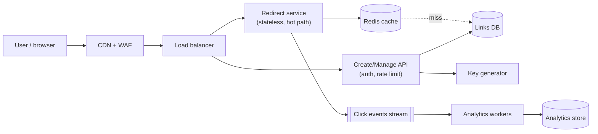
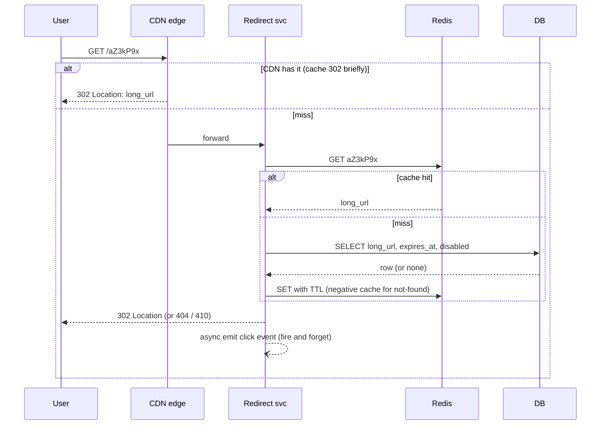
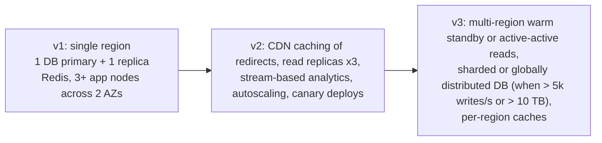

# 10. Worked Example: Designing a URL Shortener (v1 to v3)

This chapter applies the whole guide. Read it **progressively**: each step zooms in. Notice how every earlier concept shows up as a decision with a reason.

---

## Step 0: Requirements (always first)

| Type | Requirement |
|---|---|
| Functional | Create short link from long URL; redirect short to long; optional custom alias; optional expiry; basic click stats |
| Scale | 100M new links/month, 100:1 read:write, links kept 5 years |
| Latency | Redirect p99 < 50 ms (server-side) |
| Availability | 99.99% for redirects; creation can be 99.9% |
| Durability | A created link must never be lost (RPO ~ 0) |
| Security | No open-redirect abuse, malware/phishing screening, API keys with rate limits |

Observation: **redirect path is the hot, critical path**; creation and analytics are not. Design the paths separately.

## Step 1: Estimation (chapter 01 recipe)

```
Writes:  100M / 30 days / 86,400 s  = ~40 writes/s (peak ~120/s)
Reads:   100x                       = ~4,000 reads/s (peak ~12,000/s)
Storage: 100M x 12 months x 5 years = 6B records x ~500 B = ~3 TB (fits one big DB, but plan for partitioning)
Key space: base62, 7 chars = 62^7 = ~3.5 trillion  -> ample for 6B links
Cache: 20% of links get 80% of traffic: cache ~ 20% of daily-active links, a few GB -> fits in one Redis cluster
```
Conclusions: tiny write rate, read-dominated, small hot set: **cache + CDN do most of the work**; sharding is not needed on day one.

## Step 2: High-level architecture (big picture)



Decisions and reasons:
- Separate services (redirect vs create): different scaling, SLOs, and blast radius (ch 03, 04).
- Click counting is **async** via a stream so it never slows or breaks a redirect (ch 04, 07).

## Step 3: Data model and key generation (structure)

```sql
CREATE TABLE links (
  code        VARCHAR(10) PRIMARY KEY,       -- short code, also the lookup key
  long_url    TEXT        NOT NULL,
  owner_id    BIGINT      NOT NULL,
  created_at  TIMESTAMPTZ NOT NULL DEFAULT now(),
  expires_at  TIMESTAMPTZ NULL,
  disabled    BOOLEAN     NOT NULL DEFAULT false
);
CREATE INDEX idx_links_owner ON links (owner_id, created_at DESC);
```

**Key generation options**

| Approach | How | Pros | Cons |
|---|---|---|---|
| Hash of URL (truncate) | `base62(sha256(url))[:7]` | Stateless, same URL = same code | Collisions need retry; leaks nothing, but identical URLs by different users share a code |
| Random + uniqueness check | Random 7 chars, insert, retry on conflict | Simple, unguessable | One extra write attempt on collision (rare at 6B / 3.5T) |
| Counter + base62 | Global/range-allocated counter | No collisions, short | Sequential = guessable and enumerable (security), counter is a coordination point |
| Pre-generated key pool | Batch of unused keys handed to app nodes | No hot path coordination | Pool management |

Choice for v1: **random 7-char base62 with unique-constraint insert and retry**. Unguessable (security), no coordinator (resilience), simple.

## Step 4: Behaviour: the redirect hot path



Status code: **301** (permanent, cacheable by browsers: fewer hits but you lose analytics and can't revoke) vs **302/307** (not cached: every click reaches you). Choose 302 if you need stats or takedowns.

## Step 5: Implementation snippets

```js
// Redirect handler (Node/Express style)
app.get('/:code', async (req, res) => {
  const { code } = req.params;
  if (!/^[0-9A-Za-z]{4,10}$/.test(code)) return res.sendStatus(404);       // input validation

  let rec = await cache.get(code);                                          // cache-aside
  if (!rec) {
    rec = await db.findLink(code);
    await cache.set(code, rec ?? NOT_FOUND, { EX: 300 + jitter(60) });       // negative caching + TTL jitter
  }
  if (!rec || rec === NOT_FOUND || rec.disabled) return res.sendStatus(404);
  if (rec.expires_at && new Date(rec.expires_at) < new Date()) return res.sendStatus(410);

  events.emit({ code, ts: Date.now(), ua: req.get('user-agent') });         // async, bounded buffer, drop if full
  res.redirect(302, rec.long_url);
});
```
```java
// Create API: validate target, rate limit, idempotency
@PostMapping("/v1/links")
ResponseEntity<Link> create(@RequestHeader("Idempotency-Key") String key, @Valid @RequestBody CreateLink req) {
  urlPolicy.assertAllowed(req.url());     // scheme http/https only, block private IP ranges, safe-browsing check
  return ResponseEntity.status(201).body(service.createIdempotent(key, req));
}
```

## Step 6: Failure scenarios (resilience lens)

| Failure | Behaviour with this design |
|---|---|
| Redis down | Redirects fall through to DB (higher latency); circuit breaker + request coalescing stop a DB stampede; DB replicas absorb reads |
| DB primary fails | Multi-AZ failover ~60 s; **cached links keep redirecting**; creation returns 503 with `Retry-After` for that window |
| Analytics stream down | Redirects unaffected; click events buffered/dropped; analytics is eventually consistent |
| Region outage | v3 only: warm standby region, DNS/global LB failover; replica lag defines RPO |
| Traffic spike on one viral link | CDN absorbs; hot-key replicated in local in-process cache |
| Bad deploy | Canary 5% on the redirect service with SLO-based auto-rollback |

## Step 7: Security review (STRIDE-lite)

- **S**: API keys/OAuth for management API; redirects are public by design.
- **T**: only the owner may edit/disable a link (object-level authZ).
- **R**: audit log on create/disable/delete.
- **I**: don't expose owner or internal ids; unguessable codes; no sequential ids.
- **D**: per-key rate limits at the gateway; WAF; CDN absorbs floods; max URL length.
- **E**: service role can only read/write the `links` table; no admin credentials in the redirect service.
- Abuse: **open redirect/phishing** is the real product risk: scan targets at creation and periodically, support instant disable (via cache invalidation event), interstitial warning page for flagged domains.

## Step 8: Evolution: v1, v2, v3



Each step is triggered by a **measured** limit, not by fashion (ch 01, "trade-offs").

## Step 9: Cloud mapping (AWS example; Azure/GCP equivalents in chapter 11)

| Need | Service |
|---|---|
| Edge, WAF | CloudFront + AWS WAF |
| Compute | ECS Fargate (redirect + API), or EKS if the team already runs K8s |
| Cache | ElastiCache (Redis), multi-AZ |
| Database | Aurora PostgreSQL (1 writer, 2 readers) or DynamoDB with `code` as partition key |
| Click stream | Kinesis Data Streams or MSK, then Lambda/Fargate consumers to S3/Athena or ClickHouse |
| Secrets/keys | Secrets Manager, KMS CMK |
| Observability | CloudWatch + X-Ray/OpenTelemetry, SLO alarms on redirect p99 and availability |
| IaC / deploy | Terraform + CodeDeploy/Argo Rollouts canary |

DynamoDB note: the access pattern is **only** "get by code" (plus list-by-owner via a GSI), which is the textbook NoSQL fit (ch 07), giving single-digit-ms reads and no failover blip.

## Step 10: Trade-offs you should be able to defend

1. 301 vs 302 (performance/CDN cacheability vs analytics and revocation).
2. Random keys vs counter (security and simplicity vs compactness).
3. SQL vs DynamoDB (flexible queries vs scale and operations).
4. Sync vs async analytics (accuracy now vs redirect resilience).
5. Multi-region (cost, complexity) vs accepting a 99.99% Single-region multi-AZ target.

## Practice

Redo this design for: (a) a **paste-bin** (large blobs, expiry), (b) a **rate limiter service**, (c) a **notification system**. For each, run the same ten steps and compare which concepts change.
